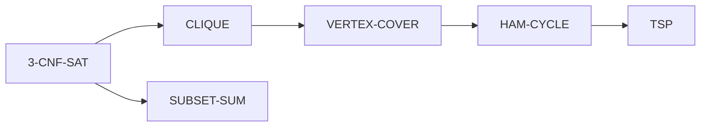

# Polynomial-Time Reductions

## What it is
Problem `A` **reduces** to `B` (`A ≤ₚ B`) if a polynomial-time function `f` maps instances of `A` to instances of `B` with `x ∈ A ⇔ f(x) ∈ B`. A fast algorithm for `B` would then solve `A` fast. A problem is **NP-complete** if it is in NP and *every* NP problem reduces to it; once [SAT](#/cnf_sat) is known to be NP-complete, proving a new problem NP-complete only requires (1) membership in NP via a [verifier](#/np_verification) and (2) **one** reduction from a known NP-complete problem.

## How it works
Three of the book's classic reductions, implemented as instance transformations:

1. **3-CNF-SAT ≤ₚ CLIQUE.** For a formula with `k` clauses, create a vertex for every literal occurrence `(clause i, literal ℓ)` and an edge between vertices of *different* clauses whose literals are not complements. A `k`-clique picks one consistent literal per clause — exactly a satisfying assignment.
2. **CLIQUE ≤ₚ VERTEX-COVER.** `G` has a clique of size `k` iff its **complement** graph has a vertex cover of size `|V| − k` (the vertices outside the clique cover every complement edge).
3. **HAM-CYCLE ≤ₚ TSP.** Put cost 0 on the edges of `G` and 1 on non-edges of a complete graph; `G` has a Hamiltonian cycle iff the TSP instance has a tour of cost ≤ 0.

## Complexity
Each construction is polynomial: `O(m²)` vertices/edges for SAT→CLIQUE (m clauses), `O(V²)` for the others. The target problems stay exponential in the worst case.

## When to use it
Prove hardness (so you stop searching for an exact polynomial algorithm and use [approximation](#/approx_vertex_cover), heuristics, or parameterised methods), and also solve problems *with* a SAT/ILP solver by reducing to it.

## In this implementation
All three transformations plus exact (exponential) `max_clique`, `min_vertex_cover` and the Held-Karp TSP to verify **equivalence** on hundreds of random instances: SAT ⇔ k-clique, clique ⇔ complement cover, Hamiltonian ⇔ zero-cost tour.
