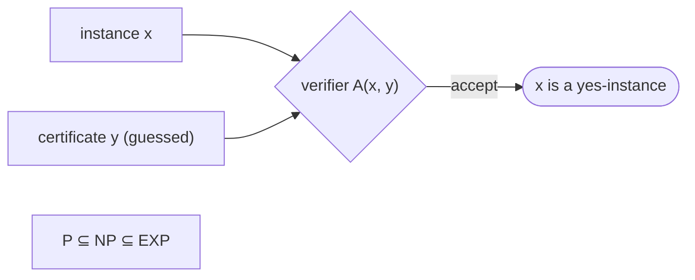

# NP Verification Algorithms

## What it is
Chapter 34 classifies problems by how hard they are to **solve** versus how easy they are to **check**.
* **P** — decision problems solvable in polynomial time.
* **NP** — problems whose "yes" instances have a **certificate** that a polynomial-time **verification algorithm** can check. (NP = *nondeterministic polynomial*, not "non-polynomial".)

`P ⊆ NP ⊆ EXP`; whether `P = NP` is the best-known open problem in computer science.

## How it works
A verifier `A(x, y)` takes an instance `x` and certificate `y` and answers in time polynomial in `|x|`:

| Problem | Certificate | Verification |
|---|---|---|
| [Hamiltonian cycle](#/hamiltonian_cycle) | a vertex permutation | each consecutive pair is an edge — O(n) |
| Clique of size k | k vertices | pairwise adjacent — O(k²) |
| Vertex cover of size k | k vertices | every edge covered — O(E) |
| [CNF-SAT](#/cnf_sat) | truth assignment | every clause has a true literal — O(size) |
| [Subset sum](#/subset_sum_np) | indices | add them up — O(n) |

Trying **all** certificates shows `NP ⊆ EXP`: exponentially many candidates, each checked in polynomial time.

## Complexity
Each verifier is polynomial; exhaustive search over `b`-bit certificates is `O(2^b · poly)`.

## When to use it
Whenever you meet a hard-looking problem, ask whether its answer is *checkable*: that is the first step toward proving NP-completeness (see [reductions](#/np_reductions)) and deciding between exact, [approximate](#/approx_vertex_cover) and heuristic approaches. Cryptography relies on the opposite hope — that some NP problems are hard on average.

## In this implementation
Verifier functions for five canonical problems, each with accepting and rejecting tests (duplicates, wrong lengths, missing edges), plus `decide_by_exhaustive_certificates` illustrating the brute-force `NP ⊆ EXP` argument.
