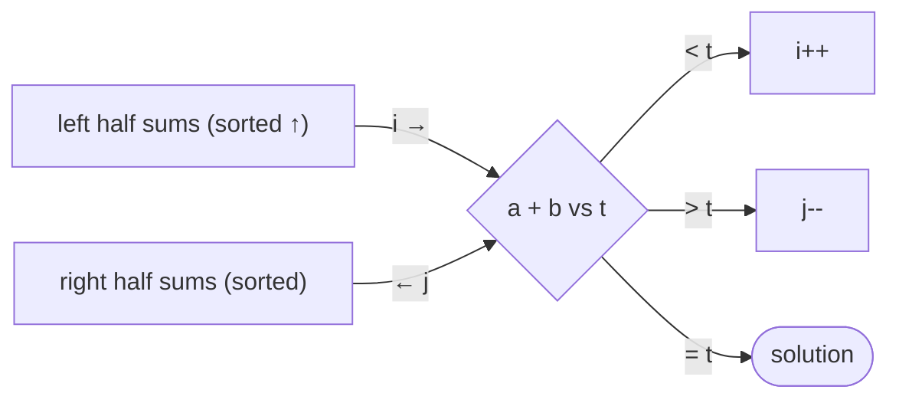

# Subset Sum

## What it is
Given a set of integers `S` and a target `t`, is there a subset summing to exactly `t`? The decision problem is **NP-complete** (Theorem 34.15, by reduction from 3-CNF-SAT) — and yet "easy" for small numbers, a standard example of a **pseudo-polynomial** algorithm.

## How it works
* **Dynamic programming** `R[i][s]` = "some subset of the first `i` numbers sums to `s`": `R[i][s] = R[i−1][s] ∨ R[i−1][s − xᵢ]`. Time and space `O(n·t)`. The input encodes `t` in `lg t` bits, so `t` is *exponential* in the input size — that's why this does not contradict NP-completeness.
* **Meet in the middle**: split `S` into two halves, list all `2^{n/2}` subset sums of each, sort, and find a pair summing to `t` with two pointers: `O(2^{n/2}·n)` time — a square-root speed-up over brute force.
* **Approximation:** the [FPTAS](#/approx_subset_sum) trades exactness for polynomial time in `n` and `1/ε`.

## Complexity
Exhaustive `Θ(2ⁿ)`; DP `Θ(nt)`; meet-in-the-middle `Θ(2^{n/2})`. Strongly NP-complete problems (e.g. [clique](#/np_reductions)) have no pseudo-polynomial algorithm unless P = NP.

## When to use it
Partition and knapsack-type budgeting ([0-1 knapsack](#/knapsack_01) is a generalisation), cryptographic knapsack systems (broken), load balancing, change-making with exact totals.

## In this implementation
All three solvers return an index set that is validated with the NP verifier; 300 random instances are cross-checked for agreement.
