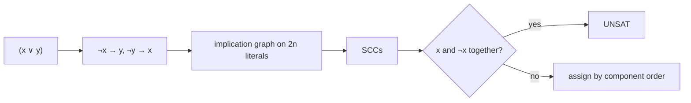

# 2-CNF Satisfiability in Polynomial Time

## What it is
[3-CNF-SAT](#/cnf_sat) is NP-complete (Section 34.4), but restricting each clause to **two** literals makes satisfiability easy. Exercise 34.4-7 asks you to show that **2-CNF-SAT is in P**. It marks the sharp boundary between tractable and intractable satisfiability: 2 literals per clause — polynomial; 3 — NP-complete.

## How it works
A clause `(a ∨ b)` is equivalent to both implications `¬a → b` and `¬b → a`. Build the **implication graph** with a vertex per literal (`2n` vertices) and two edges per clause. Then:
* If some variable `x` and its negation `¬x` lie in the **same strongly connected component**, then `x ⇔ ¬x`: the formula is **unsatisfiable**.
* Otherwise it is satisfiable, and an assignment is obtained from the component order: process components in topological order of the condensation and set literal `ℓ` true if its component comes *after* that of `¬ℓ` (so implications never go from true to false).

The proof of sufficiency uses the fact that the implication graph is *skew-symmetric* (`u → v` implies `¬v → ¬u`). It relies on [strongly connected components](#/strongly_connected_components) — here Tarjan's algorithm, which numbers components in reverse topological order.

## Complexity
`O(n + m)` for `n` variables and `m` clauses. By contrast, MAX-2-SAT (satisfy as many clauses as possible) is NP-hard.

## When to use it
Constraint propagation in compilers and type systems, scheduling with pairwise exclusions, tile/grid puzzles, and as a subroutine in many algorithms (for example, 2-colouring-like problems and certain layout problems).

## In this implementation
Variables are numbered `1…n`, literals `±v`. Tests compare with brute force on 400 random small formulas (verifying every returned assignment) and solve a 5000-variable implication chain, then make it unsatisfiable by adding the opposite unit clause.
