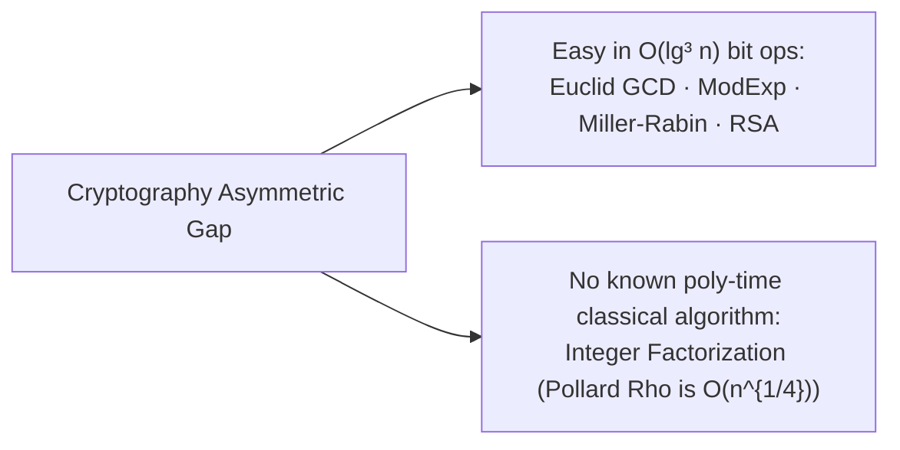

# Number-Theoretic Algorithms

## Introduction
Before public-key cryptography existed, number theory was considered the purest, least "practical" branch of mathematics. Today, every HTTPS handshake, SSH login, and digital signature runs directly on **Chapter 31 of CLRS** (`Ch. 33` in 1e). Here, the input size isn't the *value* of a number $n$, it is the **number of bits $\beta = \lg n$**—meaning an $O(\sqrt{n}) = O(2^{\beta/2})$ loop takes centuries on a 2048-bit key, while an $O(\beta^3)$ modular algorithm finishes in microseconds!

## What Problem Is It Solving?
- **Fast greatest common divisors & modular inverses:** Compute $\gcd(a,b)$ and solve $ax \equiv b \pmod n$ in polynomial bit-time ([Euclid's GCD](#/euclid_gcd), [Extended Euclid](#/extended_euclid), [Modular Linear Equations](#/modular_linear_equations), [Chinese Remainder Theorem](#/chinese_remainder)).
- **Arithmetic on astronomically huge numbers:** Compute $a^b \bmod n$ when $b$ has hundreds of digits without ever overflowing ([Modular Exponentiation](#/modular_exponentiation)), test perfect powers ([Perfect-Power Test](#/perfect_power)), or take modular square roots ([Quadratic Residues & Tonelli-Shanks](#/quadratic_residues)).
- **Encrypting & signing without a shared secret:** Generate primes, encrypt, and sign messages ([RSA Cryptosystem](#/rsa)).
- **Testing primality vs. factoring integers:** Tell whether a 1024-bit number is prime in milliseconds, versus breaking it into prime factors ([Fermat & Miller-Rabin](#/miller_rabin), [Carmichael Numbers](#/carmichael_pseudoprimes), [Pollard's Rho](#/pollard_rho)).

## Algorithms & Trade-Offs

| Problem / Comparison | Time Complexity ($\beta = \lg n$ bits) | Reliability / Catch | Key Trade-Off |
|---|---|---|---|
| **Trial Division** vs. [Euclid's GCD](#/euclid_gcd) | $O(\sqrt{n})$ vs. **$O(\lg n)$** divisions | Exact | Trial division scales exponentially in bit-length $\beta$; Euclid's GCD shrinks numbers at least as fast as Fibonacci ratios (Lamé's theorem). |
| [Extended Euclid](#/extended_euclid) vs. Fermat Inverse | $O(\lg n)$ vs. $O(\lg p)$ mod-muls | Extended Euclid works for **any** $\gcd(a,n)=1$; $a^{p-2} \bmod p$ needs prime $p$ | Extended Euclid works on composite moduli (like RSA's $\phi(n)$); $a^{p-2} \bmod p$ is handy when $p$ is prime and you already have `mod_pow`. |
| **Fermat Test** vs. [Miller-Rabin](#/miller_rabin) | Both $O(s \lg^3 n)$ for $s$ witnesses | Fermat fails completely on [Carmichael Numbers](#/carmichael_pseudoprimes)! | Carmichael numbers like `561` pass Fermat's test for *every* coprime base; Miller-Rabin adds square-root-of-1 checks so **every** composite fails at least $3/4$ of witnesses (error $\le 4^{-s}$). |
| [Miller-Rabin](#/miller_rabin) (Primality) vs. [Pollard's Rho](#/pollard_rho) (Factoring) | Polynomial $O(\lg^3 n)$ vs. Exponential $O(n^{1/4})$ | Probabilistic | **Asymmetry of primes:** Proving a 2048-bit number is composite/prime is easy; actually *finding* its factors via Pollard's rho is infeasible at RSA key sizes—that gap is why RSA works! |
| **Naive Loop** vs. [Modular Exponentiation](#/modular_exponentiation) | $\Theta(b)$ vs. **$\Theta(\lg b)$** multiplications | Exact | Repeated squaring turns $2^{1000}$-step loops into ~1000 squarings. |
| [Chinese Remainder Theorem](#/chinese_remainder) | $O(k^2 + k \lg n)$ | Coprime moduli (generalized via Extended Euclid) | Splits arithmetic modulo huge $N = p \cdot q$ into tiny independent operations modulo $p$ and $q$ (gives a ~4× speedup for RSA decryption!). |

## Quick Rules of Thumb for CS Students
- **Input size in number theory is $\lg n$, not $n$:** An algorithm running in $\Theta(n)$ time is *exponential* in the number of input digits! Always aim for $O(\text{poly}(\lg n))$.
- **Watch out for integer overflow:** Computing `(a * b) % m` on 64-bit integers overflows if $a, b < 2^{64}$—promote intermediate products to `u128` before taking `% m`.
- **Primality is in P, Factoring is believed hard:** You don't need to factor a number just to know it's composite ([Miller-Rabin](#/miller_rabin) proves compositeness without ever finding a factor!).
