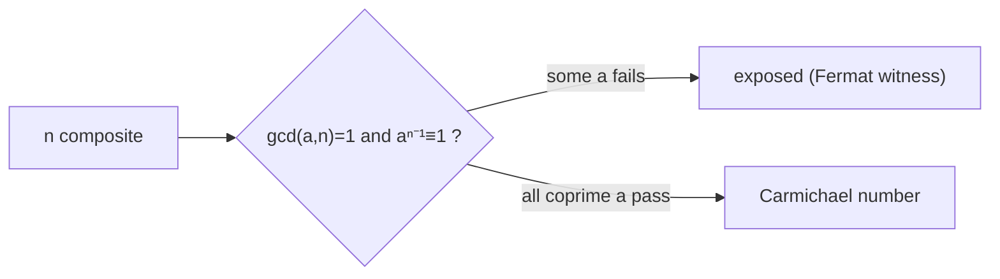

# Pseudoprimes and Carmichael Numbers

## What it is
**Fermat's little theorem** says that if `p` is prime then `a^(p−1) ≡ 1 (mod p)` for all `a` not divisible by `p`. Section 31.8 asks whether the converse can be used as a primality test: declare `n` prime when `2^(n−1) ≡ 1 (mod n)`. It almost works. A composite that passes is a **base-`a` pseudoprime**; the smallest base-2 pseudoprime is `341 = 11·31`. Worse, **Carmichael numbers** (smallest: `561 = 3·11·17`) are composite yet satisfy the congruence for *every* `a` coprime to `n`, so no choice of base within the coprime residues can expose them.

## How it works
* **PSEUDOPRIME test:** compute `a^(n−1) mod n` by [modular exponentiation](#/modular_exponentiation); answer "prime?" when the result is 1. Never wrong for primes; wrong for rare composites.
* **Korselt's criterion** characterises Carmichael numbers without testing every base: `n` is Carmichael iff it is composite, **squarefree**, and `(p − 1) | (n − 1)` for each prime `p | n`. For `561`: `2|560`, `10|560`, `16|560`.
* There are infinitely many Carmichael numbers (Alford–Granville–Pomerance, 1994), so Fermat's test alone is not a reliable primality test; the strong test of [Miller–Rabin](#/miller_rabin) closes the gap by also looking at square roots of 1.

## Complexity
One Fermat test: `O(lg n)` multiplications modulo `n`. Korselt's check by trial division: `O(√n)`.

## When to use it
To understand why probabilistic primality tests need the *strong* variant, and to build test suites for primality code: Carmichael numbers are the standard adversarial inputs.

## In this implementation
Tests check that the definition (all coprime bases) agrees with Korselt's criterion for all `n < 3000`, reproduce the classical lists (`341, 561, 645` and the seven Carmichael numbers below `10⁴`), and verify that primes pass for every base.
