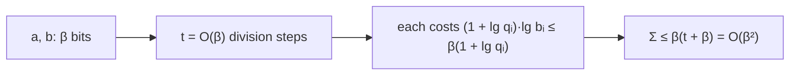

# Bit Operations in Euclid's Algorithm

## What it is
[Euclid's algorithm](#/euclid_gcd) is usually analysed by counting division steps (Lamé's theorem: `O(lg b)` of them). When the numbers are `β`-bit integers, each division costs more than one unit. Problem 31-2 asks you to count **bit operations** and show that `EUCLID(a, b)` takes `O(β²)` of them — the same as multiplying two `β`-bit numbers by the schoolbook method.

## How it works
Dividing `a` by `b` with the schoolbook method produces the quotient `q = ⌊a/b⌋` (about `lg q + 1` bits) and a remainder, and costs `O((1 + lg q)·lg b)` bit operations: for each of the quotient's bits, one `lg b`-bit subtraction. Let `q₁, q₂, …, q_t` be the quotients of the successive steps. Then

* the product `q₁ q₂ ⋯ q_t ≤ a` (each quotient is at most the ratio of consecutive remainders, so the ratios multiply to at most `a`), hence `Σ lg q_i ≤ lg a = β`;
* the number of steps is `t = O(β)` by Lamé's theorem;
* every divisor has at most `β` bits.

Therefore the total is `Σ (1 + lg q_i)·lg b_i ≤ β · (t + Σ lg q_i) = β · O(β) = O(β²)`. With the extended algorithm the same bound holds for finding the Bézout coefficients.

## Complexity
`O(β²)` bit operations, `O(β)` division steps.

## When to use it
To decide what dominates in modular-arithmetic code (RSA key generation does thousands of gcds and modular inverses), and as the standard exercise in separating *arithmetic* complexity from *bit* complexity. Sub-quadratic gcd algorithms (half-gcd) exist for huge inputs.

## In this implementation
`euclid_cost` returns the gcd, the number of steps, the modelled bit operations and `Σ lg q`. Tests check `gcd` against [`euclid_gcd`](#/euclid_gcd), the bounds `Σ lg q ≤ β + t` and `cost ≤ 3β²` on 2 000 random pairs of all sizes, and that consecutive Fibonacci numbers (the worst case for the step count) take many steps yet stay within the bound.
