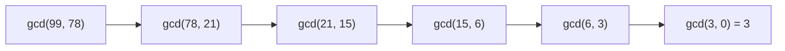

# Euclid's GCD Algorithm

## What it is
The **greatest common divisor** `gcd(a, b)` is the largest integer dividing both. Euclid's algorithm, from about 300 BC, is the oldest non-trivial algorithm still in everyday use.

## How it works
The recursion theorem `gcd(a, b) = gcd(b, a mod b)` (since any common divisor of `a, b` also divides `a mod b`, and vice versa) with `gcd(a, 0) = a`:

```
EUCLID(a, b):  if b = 0 return a else return EUCLID(b, a mod b)
```
**Running time (Lamé's theorem).** If `a > b ≥ 1` and `b < F_{k+1}` then EUCLID makes fewer than `k` recursive calls; the worst case is two consecutive Fibonacci numbers. Hence `O(lg b)` division steps.

**Binary GCD (Problem 31-1)** avoids division: if both are even, factor out 2; if one is even drop its factors of 2; if both are odd replace the larger by the difference (which is even). Only shifts and subtractions — attractive in hardware without a divider.


Also: `lcm(a,b) = a·b / gcd(a,b)` and `gcd(a₁,…,aₙ)` by folding.

## Complexity
`O(lg b)` arithmetic steps (`O(lg² b)` bit operations); binary GCD `O(lg a + lg b)` steps of `O(1)` word operations.

## When to use it
Reducing fractions, modular arithmetic ([extended Euclid](#/extended_euclid)), RSA key generation, lattice reduction, rational reconstruction.

## In this implementation
`gcd`, step counter `gcd_steps` (checks Lamé's bound on Fibonacci inputs), `binary_gcd`, `lcm` and `gcd_many`; tests compare binary and classical results on random 64-bit values.
