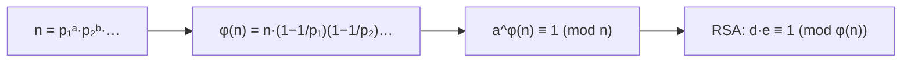

# Euler's Totient Function

## What it is
`φ(n)` is the number of integers in `1…n` that are **coprime** to `n` — the size of the multiplicative group `Z*ₙ` of Section 31.3. It is the exponent that appears in **Euler's theorem**, `a^φ(n) ≡ 1 (mod n)` for `gcd(a, n) = 1`, which generalises Fermat's little theorem and underlies [RSA](#/rsa): the modulus `n = pq` has `φ(n) = (p−1)(q−1)`.

## How it works
`φ` is multiplicative (`φ(mn) = φ(m)φ(n)` for coprime `m, n`) and `φ(pᵏ) = pᵏ − pᵏ⁻¹`, so

`φ(n) = n · ∏_{p | n} (1 − 1/p)`.

* **Single value:** factor `n` by trial division and apply the formula, `O(√n)`.
* **All values up to N:** a sieve. Start with `φ[m] = m`; whenever an entry still equals its index (so it is prime), subtract `φ[m]/p` from every multiple `m` of that prime. `O(N lg lg N)`.
* **Gauss's identity:** `Σ_{d | n} φ(d) = n`.

## Complexity
`O(√n)` per value; `O(N lg lg N)` for the table of all `φ(1..N)`.

## When to use it
Computing RSA private exponents, reducing huge exponents modulo `φ(n)`, counting primitive roots (`φ(φ(p))` of them for a prime `p`), and number-theoretic functions that are sieved together.

## In this implementation
Tests compare both routines with direct counting for `n ≤ 500`, check `Σ_{d|n} φ(d) = n`, and check Euler's theorem for every unit modulo each `n < 300` using this repository's [`mod_pow`](#/modular_exponentiation).
