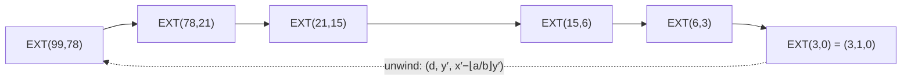

# Extended Euclid & Modular Inverses

## What it is
Bézout's identity states that for integers `a, b` there exist integers `x, y` with `ax + by = gcd(a, b)`. **EXTENDED-EUCLID** computes them along with the gcd, in the same `O(lg b)` time as [Euclid's algorithm](#/euclid_gcd).

## How it works
Run EUCLID recursively and unwind: if `d = b·x′ + (a mod b)·y′`, then since `a mod b = a − ⌊a/b⌋·b`,

`d = a·y′ + b·(x′ − ⌊a/b⌋·y′)`,

so `(x, y) = (y′, x′ − ⌊a/b⌋·y′)`. Base case: `EXTENDED-EUCLID(a, 0) = (a, 1, 0)`.

**Modular inverse.** If `gcd(a, n) = 1` then `ax + ny = 1`, i.e. `ax ≡ 1 (mod n)`: `x mod n` is the multiplicative inverse `a⁻¹`. If `gcd(a, n) > 1`, no inverse exists. (Example: `99·(−11) + 78·14 = 3`.)

## Complexity
`O(lg b)` arithmetic operations.

## When to use it
Solving [modular linear equations](#/modular_linear_equations), the [Chinese remainder theorem](#/chinese_remainder), computing the private exponent in [RSA](#/rsa), division in finite fields (ECC, AES's GF(2⁸)), and solving linear Diophantine equations.

## In this implementation
`extended_euclid` follows the pseudocode on `i64`; `mod_inverse` normalises negative inputs. Tests assert Bézout's identity on random pairs and the book's `(3, −11, 14)` example.
