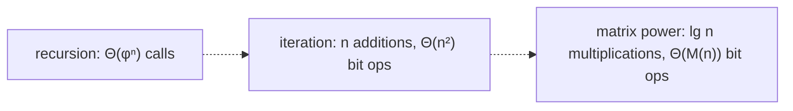

# Three Algorithms for Fibonacci Numbers

## What it is
`F₀ = 0, F₁ = 1, F_n = F_{n−1} + F_{n−2}`. Problem 31-3 compares three ways to compute `F_n` and asks for their running times both in arithmetic operations and in **bit operations**, since `F_n` has about `0.694·n` bits, so the numbers themselves grow.

## How it works
* **Naive recursion** follows the definition. The number of calls satisfies `T(n) = T(n−1) + T(n−2) + 1`, which solves to `2F_{n+1} − 1 = Θ(φⁿ)` (`φ ≈ 1.618`): exponential in `n`, as the same subproblems are recomputed again and again.
* **Iteration / memoisation** keeps the last two values: `n − 1` additions, `Θ(n)` arithmetic operations — each addition of numbers up to `0.694n` bits costs `Θ(n)` bit operations, so `Θ(n²)` in total.
* **Matrix power.** The identity `[[1,1],[1,0]]ⁿ = [[F_{n+1}, F_n],[F_n, F_{n−1}]]` and [repeated squaring](#/modular_exponentiation) give `F_n` with `O(lg n)` multiplications of `2×2` matrices (`Θ(lg n)` arithmetic operations). Bit-wise the cost is dominated by the last multiplications of `Θ(n)`-bit numbers: `Θ(M(n))`, where `M(n)` is the cost of multiplying `n`-bit numbers — `n²` schoolbook, `n^1.585` with [Karatsuba](#/karatsuba), `n lg n` with the [FFT](#/polynomial_multiplication). With fast multiplication this beats iteration's `Θ(n²)` for large `n`.
* (Also: `F_n = ⌊φⁿ/√5 + ½⌋`, correct only while floating point has enough precision, and *fast doubling* `F_{2k} = F_k(2F_{k+1} − F_k)`.)

## Complexity
Recursion `Θ(φⁿ)`; iteration `Θ(n)` operations / `Θ(n²)` bit operations; matrix power `Θ(lg n)` operations / `Θ(M(n))` bit operations.

## When to use it
Whenever a linear recurrence must be advanced by a huge number of steps (linear recurrences of any order work the same way with a bigger matrix) — also modulo `m`, where every operation is `O(1)`-bit-ish.

## In this implementation
Values use `u128`; the matrix method needs `F_{n+1}` to fit, so it is valid up to `F₁₈₄`. Tests check that iteration and matrix power agree for all `n ≤ 184`, that the recursion makes exactly `2F_{n+1} − 1` calls, and that the matrix method uses at most `2⌈lg n⌉`-ish multiplications.
