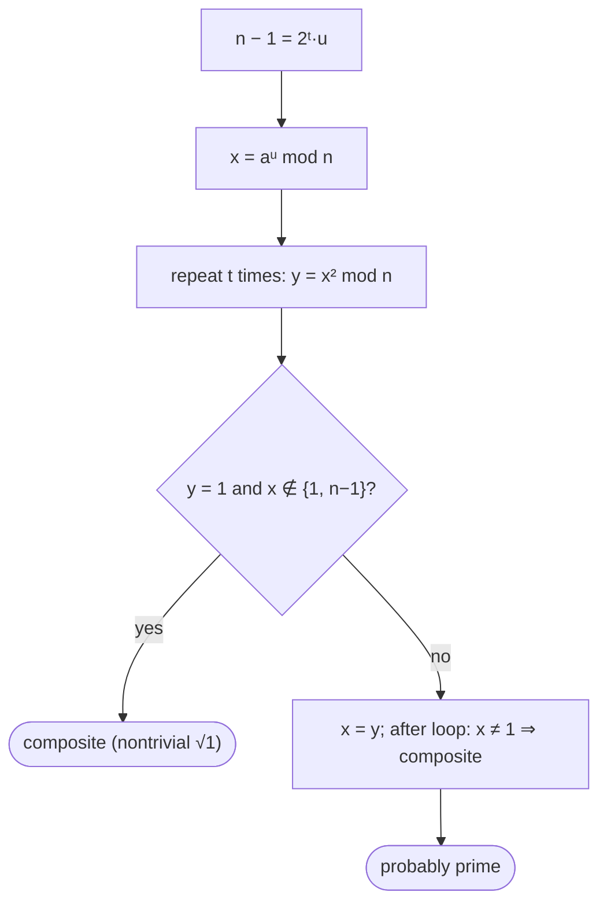

# Primality Testing: Fermat & Miller-Rabin

## What it is
Deciding whether a huge number is prime is essential for cryptography (RSA needs primes of hundreds of digits), yet trial division is exponential in the number of digits. Section 31.8 develops fast **probabilistic** tests.

## How it works
**Pseudoprimality (Fermat) test.** If `n` is prime then `2^{n−1} ≡ 1 (mod n)`. The converse is false for a few composites — *pseudoprimes* (341 is the smallest) — and fails for *every* base on **Carmichael numbers** such as `561 = 3·11·17`.

**Miller–Rabin.** Write `n − 1 = 2ᵗ·u` with `u` odd. For a random base `a`, compute `x₀ = a^u mod n` and square repeatedly: `x_i = x_{i−1}² mod n`. The base `a` is a **witness** to compositeness if either the sequence never reaches 1 (Fermat fails) or it reaches 1 from a value other than ±1 — a **nontrivial square root of 1**, impossible modulo a prime.

Theorem 31.38: for an odd composite `n`, at least `3/4` of the bases are witnesses (the book proves `1/2`). So with `s` random bases: a "composite" verdict is always right; a "prime" verdict errs with probability at most `2^{−s}` (really `4^{−s}`).

## Complexity
`O(s·β)` modular multiplications for `β`-bit `n`, i.e. `O(s β³)` bit operations. For `n < 2⁶⁴` the 12 bases 2,3,5,…,37 make it fully **deterministic**.

## When to use it
Generating primes for [RSA](#/rsa), Diffie–Hellman and DSA parameters; the first step of integer factoring ([Pollard rho](#/pollard_rho)); language libraries' `isProbablePrime`.

## In this implementation
`witness`, randomized `miller_rabin`, deterministic `is_prime` for `u64`, and the Fermat `pseudoprime`. Tests compare with a sieve up to 30 000, show Carmichael numbers fooling Fermat, and check the largest 64-bit prime.
