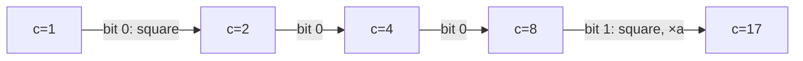

# Modular Exponentiation

## What it is
Computing `aᵇ mod n` for huge `b` (hundreds of digits in cryptography) by multiplying `b` times is hopeless. **Repeated squaring** needs only `O(lg b)` multiplications, each on numbers smaller than `n`.

## How it works
Write `b` in binary `⟨b_k, …, b₀⟩`. Process the bits from the most significant: maintain `d = a^c mod n` where `c` is the prefix of `b` read so far. For each bit, **square** (`c → 2c`) and, if the bit is 1, **multiply by `a`** (`c → c+1`):

```
d ← 1
for i = k downto 0:
    d ← d·d mod n
    if bᵢ = 1: d ← d·a mod n
```
Example: `7^560 mod 561` with `560 = 1000110000₂` takes 10 squarings and 3 multiplications and returns 1 (561 = 3·11·17 is a Carmichael number — see [primality testing](#/miller_rabin)).


The same code works for any group (matrices — Fibonacci in `O(lg n)`; elliptic curves — scalar multiplication). Related notions from Section 31.3: the **order** of `a` mod `n` is the least `t > 0` with `aᵗ ≡ 1`; a **primitive root** has order `φ(n)`; Fermat: `a^{p−1} ≡ 1 (mod p)` for prime `p`.

## Complexity
`O(β)` modular multiplications, `O(β³)` bit operations for `β`-bit numbers.

## When to use it
[RSA](#/rsa) encryption/decryption/signing, Diffie–Hellman, [primality tests](#/miller_rabin), discrete-log protocols, hashing.

## In this implementation
`mod_pow` uses `u128` intermediates so any 64-bit modulus is safe; `order` and `primitive_root` illustrate the group structure. Tests compare with the naive power for all small cases.
