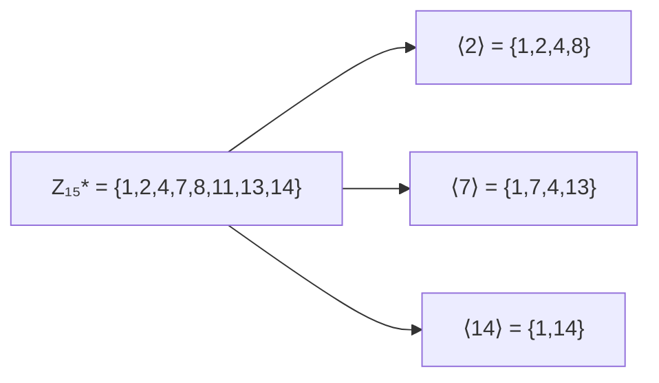

# Modular Groups & Euler's Totient

## What it is
Section 31.3 introduces finite groups through modular arithmetic. Two groups matter: `(Z_n, +)`, the integers mod `n` under addition, and `(Z_n*, ·)`, the **units** — residues relatively prime to `n` — under multiplication. Its size is **Euler's totient** `φ(n)`.

## How it works
* `φ(n) = n·Π_{p | n}(1 − 1/p)`; for a prime `p`, `φ(p) = p − 1`.
* **Lagrange's theorem**: the order of any subgroup divides the order of the group. Hence for `a ∈ Z_n*` the order of `a` divides `φ(n)`, which gives **Euler's theorem** `a^{φ(n)} ≡ 1 (mod n)` and **Fermat's little theorem** `a^{p−1} ≡ 1 (mod p)`.
* The **subgroup generated by `a`** is `⟨a⟩ = {a⁰, a¹, a², …}`; if `⟨a⟩ = Z_n*` then `a` is a **primitive root** (generator) and the group is *cyclic*. `Z_n*` is cyclic iff `n ∈ {1, 2, 4, p^k, 2p^k}`; then there are `φ(φ(n))` generators.

## Complexity
`φ(n)` by trial division: `O(√n)`; subgroup/order by repeated multiplication `O(order)`.

## When to use it
The theory behind [RSA](#/rsa), [Miller–Rabin](#/miller_rabin), Diffie–Hellman (needs a generator of a large cyclic group) and discrete-log based cryptography.

## In this implementation
`units`, `totient`, `subgroup`, `is_primitive_root`; tests verify `|Z_n*| = φ(n)`, Lagrange's and Euler's theorems for all `n < 80`, and the `φ(p−1)` count of primitive roots.
