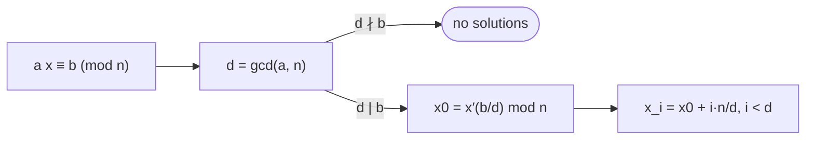

# Modular Linear Equations

## What it is
Solve `a·x ≡ b (mod n)` for `x`. Section 31.4 characterises the solutions with the gcd and [extended Euclid](#/extended_euclid).

## How it works
Let `d = gcd(a, n)` and `(d, x′, y′)` be returned by EXTENDED-EUCLID(a, n), so `ax′ + ny′ = d`.

* If `d ∤ b` there is **no** solution (every combination `ax + ny` is a multiple of `d`).
* If `d | b`, one solution is `x₀ = x′·(b/d) mod n`, and the full set is exactly the `d` residues

  `x_i = x₀ + i·(n/d)  (mod n),  i = 0, 1, …, d−1`.

When `gcd(a, n) = 1` there is a unique solution `x = a⁻¹b mod n`.

(Example: `14x ≡ 30 (mod 100)` has the two solutions `x = 45` and `95`.)

## Complexity
`O(lg n + gcd(a, n))` arithmetic operations (the gcd-many solutions are listed).

## When to use it
Linear congruential generators, solving for keys in affine ciphers, decoding periodic schedules, and as the building step of the [Chinese remainder theorem](#/chinese_remainder).

## In this implementation
Inputs may be negative (they are reduced first). The tests check **every** `(a, b, n)` with `n < 40` against brute-force enumeration.
