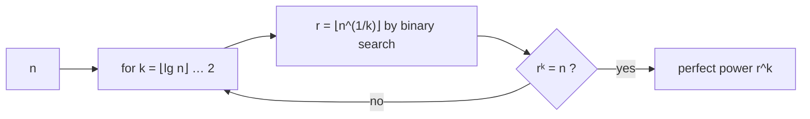

# Perfect-Power Test

## What it is
A positive integer `n` is a **perfect power** if `n = bᵏ` for integers `b > 1` and `k > 1`. Testing this is a classic exercise in Chapter 31 and a required pre-check in primality and factoring algorithms: [Miller–Rabin](#/miller_rabin) works on odd composites, but a prime power such as `p²` hides the factor in a way that some algorithms (for example [Pollard's rho](#/pollard_rho)) handle poorly.

## How it works
If `n = bᵏ` with `b ≥ 2` then `2ᵏ ≤ n`, so `k ≤ ⌊lg n⌋`. For every candidate `k`:
1. compute the integer root `r = ⌊n^(1/k)⌋` by **binary search** on `r` (compare `rᵏ` with `n` using overflow-safe multiplication);
2. `n` is a `k`-th power iff `rᵏ = n`.

Take the largest `k` that works to get the canonical representation (for example `64 = 2⁶`, not `8²`).

## Complexity
`⌊lg n⌋` exponents × `O(lg n)` binary-search steps × `O(lg n)` multiplications: polynomial in the input length `β = lg n`, namely `O(β³)` arithmetic steps.

## When to use it
As the first step of deterministic primality tests (AKS begins with this very test), when preparing RSA moduli (a modulus `p²` is insecure), and in factoring programs.

## In this implementation
`kth_root` and `perfect_power` use checked arithmetic so that values up to `2⁶⁴ − 1` are safe. Tests compare against exhaustive search for all `n < 6000` and check large cases such as `3²⁰` and `2⁶²`.
