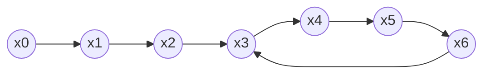

# Pollard's Rho Integer Factorization

## What it is
Factoring a composite `n` has no known polynomial-time classical algorithm, and the security of [RSA](#/rsa) rests on that. Trial division needs `Θ(√n)` steps. Pollard's **rho** heuristic (1975) finds a factor in expected `O(n^{1/4})` steps using almost no memory. The method appears in Section 31.9 of the first three editions (the fourth edition dropped factorization).

## How it works
Iterate the pseudo-random map `x_{i+1} = (x_i² − 1) mod n` (here `x² + c`). Let `p` be a (still unknown) prime factor of `n`. The sequence `x_i mod p` lives in a set of only `p` values, so by the birthday paradox it repeats after about `√p` steps — much sooner than the sequence mod `n`. When `x_i ≡ x_j (mod p)` but `x_i ≢ x_j (mod n)`, the number `gcd(|x_i − x_j|, n)` is a nontrivial factor!

To detect the repetition without storing the sequence use **Floyd's cycle detection**: advance a tortoise by one step and a hare by two, computing `gcd(|x − y|, n)` each time. The trajectory looks like the Greek letter ρ (a tail leading into a cycle).

Expected steps `Θ(√p) = O(n^{1/4})` when `p ≤ √n`.

## Complexity
Expected `O(n^{1/4})` arithmetic operations (heuristic), `O(1)` space. Combined with [Miller–Rabin](#/miller_rabin) it factors numbers up to ~10¹⁸ instantly.

## When to use it
Factoring moderate numbers, hunting small factors in cryptanalysis exercises, and discrete logarithms (the same idea gives Pollard's rho for logs). Large RSA moduli require the quadratic/number-field sieves.

## In this implementation
Retries with new constants when `gcd = n`; `factorize` first strips primes below 100, then splits recursively using the deterministic primality test. Tests multiply the factors back for 100 random numbers up to 10¹².
