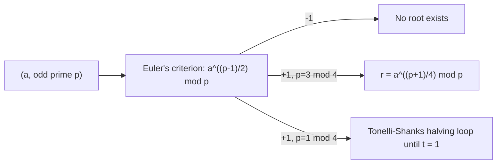

# Quadratic Residues & Tonelli-Shanks

## What it is
Given an odd prime $p$ and integer $a$, $a$ is a **quadratic residue** modulo $p$ if $x^2 \equiv a \pmod p$ has a solution. Half of $\mathbb{Z}_p^*$ are quadratic residues (each having two square roots $\pm r \bmod p$) and half are non-residues.

## How it works
1. **Euler's Criterion (`legendre_symbol`)**: For $p \nmid a$, Legendre symbol $\left(\frac{a}{p}\right) \equiv a^{(p-1)/2} \pmod p \in \{+1, -1\}$, computed in $O(\lg p)$ multiplications via [modular exponentiation](#/modular_exponentiation).
2. **Tonelli–Shanks (`mod_sqrt`)**:
   * When $p \equiv 3 \pmod 4$, $(p+1)/4$ is an integer and $r = a^{(p+1)/4} \bmod p$ works directly in one exponentiation.
   * For general $p \equiv 1 \pmod 4$, write $p - 1 = Q \cdot 2^S$ with $Q$ odd, pick any non-residue $z$, and set $c = z^Q$, $t = a^Q$, $r = a^{(Q+1)/2}$. Repeatedly find the smallest $i$ with $t^{2^i} \equiv 1$, multiply $r$ by $c^{2^{m-i-1}}$ and $t$ by its square so the 2-adic order of $t$ strictly drops until $t = 1$, leaving $r^2 \equiv a \pmod p$.

## Complexity
* **Legendre symbol**: $O(\lg p)$ modular multiplications.
* **Tonelli–Shanks**: $O(\lg^2 p)$ worst-case modular multiplications (finding non-residue $z$ takes $O(1)$ expected trials since half of $\mathbb{Z}_p^*$ are non-residues).

## When to use it
Essential in elliptic curve point decompression, quadratic sieve / number field sieve factorization (beyond [Pollard rho](#/pollard_rho)), and cryptographic zero-knowledge / Rabin cryptosystems.

## In this implementation
`legendre_symbol` and `mod_sqrt` validate every element modulo every prime $p \le 200$ exhaustively and sample residues for all primes up to $1000$, confirming both $\pm r$ roots square back to $a \bmod p$.
