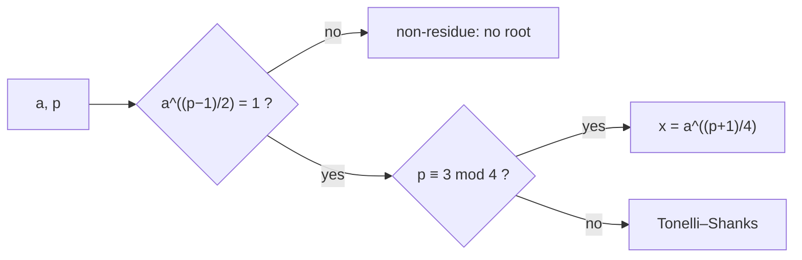

# Quadratic Residues and Square Roots Modulo a Prime

## What it is
An integer `a` is a **quadratic residue** modulo `n` if `x² ≡ a (mod n)` has a solution. Problem 31-4 develops the theory for an odd prime `p`: (a) exactly half of the non-zero residues are quadratic residues, (b) **Euler's criterion** — `a^((p−1)/2) ≡ 1` for residues and `≡ −1` for non-residues — gives an `O(lg p)` test via [modular exponentiation](#/modular_exponentiation), (c) for `p ≡ 3 (mod 4)` a square root is simply `a^((p+1)/4)`, and (d) for other primes there is a randomised (or Tonelli–Shanks) polynomial-time algorithm.

## How it works
* **Counting.** The map `x ↦ x²` on `Z*_p` is exactly two-to-one (`x` and `−x`), so there are `(p − 1)/2` squares.
* **Euler's criterion.** `(a/p) = a^((p−1)/2) mod p` is the **Legendre symbol** (`1`, `−1`, or `0`). It follows from Fermat's theorem: if `a = g^k` for a generator `g`, then `a^((p−1)/2) = (−1)^k`.
* **Square roots when `p ≡ 3 (mod 4)`:** `x = a^((p+1)/4)` since `x² = a^((p+1)/2) = a · a^((p−1)/2) = a`.
* **Tonelli–Shanks** (general `p`): write `p − 1 = q·2^s` with `q` odd. Start from `r = a^((q+1)/2)` and `t = a^q` and repeatedly correct `r` by a power of a fixed non-residue until `t = 1`, i.e. work down the 2-power subgroup. `O(lg² p)`.

## Complexity
Euler's criterion `O(lg p)` multiplications; square root `O(lg p)` for `p ≡ 3 (mod 4)`, `O(lg² p)` in general.

## When to use it
Elliptic-curve cryptography (finding a point `y` from `x`, point decompression), the Rabin cryptosystem, quadratic sieve factoring, and primality tests such as Solovay–Strassen.

## In this implementation
Tests verify that for every prime `p < 300` exactly `(p−1)/2` distinct squares exist and Euler's criterion agrees with the list of squares, that `sqrt_mod` returns a true root (or correctly reports a non-residue) for **every** `a` and all primes below 400 — covering both `p ≡ 1` and `p ≡ 3 (mod 4)` — and checks large primes (`10⁹+7` and `998 244 353`).
