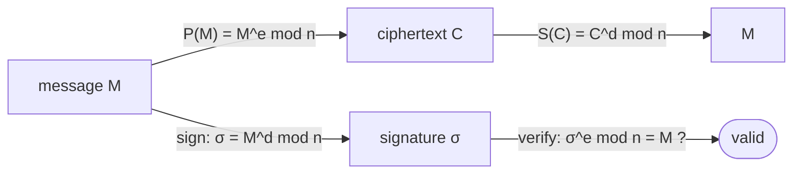

# RSA Public-Key Cryptosystem

## What it is
In a **public-key cryptosystem** each participant has a public key `P` (published) and a secret key `S`, with `S(P(M)) = M`. **RSA** (Rivest–Shamir–Adleman, 1977) bases its security on the apparent difficulty of factoring large numbers — a showcase of the number-theoretic algorithms of Chapter 31.

## How it works
**Key generation:**
1. Pick two large distinct primes `p, q` (with [Miller–Rabin](#/miller_rabin)); `n = pq`.
2. Pick a small odd `e` relatively prime to `φ(n) = (p−1)(q−1)`.
3. Compute `d = e⁻¹ mod φ(n)` with [extended Euclid](#/extended_euclid).
4. Public key `P = (e, n)`, secret key `S = (d, n)`.

**Operations** (all by [modular exponentiation](#/modular_exponentiation)): `P(M) = Mᵉ mod n`, `S(C) = C^d mod n`.

**Correctness:** `ed ≡ 1 (mod φ(n))`, so `ed = 1 + k(p−1)(q−1)`; by Fermat's theorem `M^{ed} ≡ M (mod p)` and `(mod q)`, hence `(mod n)` by the [CRT](#/chinese_remainder).

**Signatures:** sign with the secret key `σ = S(M)`; anyone checks `P(σ) = M`.

Book example: `p = 11, q = 29, n = 319, φ = 280, e = 3, d = 187`; `P(100) = 254`.

## Complexity
Encryption with small `e`: `O(β²)`; decryption `O(β³)` bit operations for `β`-bit `n`. Breaking RSA needs factoring `n`: sub-exponential with the number-field sieve (and polynomial with a quantum computer — Shor).

## When to use it
Key exchange and digital signatures in TLS/SSH/PGP (always with padding like OAEP/PSS; "textbook RSA" shown here is insecure).

## In this implementation
Toy-size keys (up to two 31-bit primes so `n` fits in a `u64`); the book's `p=11, q=29` example is a test, along with random round trips and signature verification/tamper detection.
