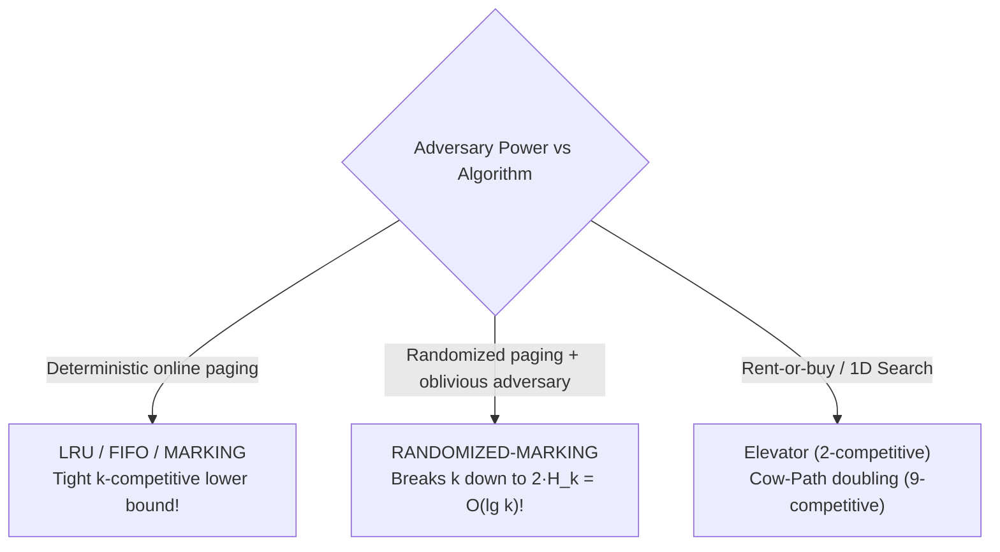

# Online Algorithms

## Introduction
Most algorithms in CLRS get to inspect the *entire input* up front before making a single decision. **Online Algorithms**—newly elevated to **Chapter 27 in the 4th edition**—model real life when **you must make irrevocable choices right now without knowing the future**: Should I keep waiting for the elevator or take the stairs? Which page should the CPU cache evict when the next memory read hasn't happened yet? Instead of absolute runtime, you measure **competitive ratio**: how much worse your online strategy performs compared to an omniscient "offline" prophet (`OPT`) who saw the future in advance!

## What Problem Is It Solving?
- **Rent-or-buy decisions under uncertainty:** Decide when to stop paying small recurring costs and commit to a fixed one-time cost ([Waiting for an Elevator / Ski Rental](#/elevator)).
- **Searching unknown unbounded directions:** Locate a hidden target along a line when you don't know left vs. right or how far away it is ([The Cow-Path Problem](#/cow_path)).
- **Adapting pointer lists to skewed access patterns:** Reorganize a linked list on the fly without knowing future lookups ([Self-Organizing Lists: Move-to-Front](#/move_to_front)).
- **Cache replacement (paging):** Evict one item from a size-$k$ cache on a miss so total misses stay close to Belady's offline optimum ([Online Caching: LRU, FIFO, Belady](#/online_caching), [Randomized Marking](#/randomized_marking)).

## Algorithms & Trade-Offs

| Problem / Policy | Competitive Ratio | Deterministic vs. Randomized | Key Trade-Off |
|---|---|---|---|
| [Waiting for an Elevator](#/elevator) (threshold $k$) | **$2$-competitive** at $k = \text{stairs\_time}$ | Deterministic (1.58 with randomization!) | Waiting forever risks infinite loss; walking immediately pays $\text{OPT}$ too early. Matching sunk cost to the one-time cost guarantees $\le 2\times \text{OPT}$ regardless of when the elevator arrives! |
| [Cow-Path Doubling Search](#/cow_path) ($r = 2$) | **$9$-competitive** ($1 + 2r^2/(r-1)$) | Deterministic | Expanding probes by fixed step $+1$ takes $O(d^2)$ steps! Doubling alternation (`1, 2, 4, 8, ...`) keeps distance linear in $|d|$ with tight optimal ratio $9$. |
| [Move-to-Front (MTF)](#/move_to_front) vs. Best Static List | **$4$-competitive** (against dynamic optimal!) | Deterministic | Moving each accessed node to the head beats *any* fixed list order within a constant factor (`2x` access-only, `4x` general) and adapts immediately when hot keys shift—unlike static frequency counts. |
| **Belady (`OPT`)** vs. [LRU / FIFO / LFU](#/online_caching) | Optimal (`1`) vs. **$k$-competitive** (LFU unbounded!) | Offline vs. Deterministic Online | Belady evicts the page needed *furthest in the future* (impossible online!). Any deterministic cache policy suffers ratio $\ge k$ on a cyclic $(k+1)$-page loop, **and** naive LFU can cling to stale pages forever (unbounded ratio!). |
| [Deterministic MARKING](#/randomized_marking) vs. [RANDOMIZED-MARKING](#/randomized_marking) | $k$ vs. **$2 H_k = O(\lg k)$** expected | Deterministic vs. Randomized | By choosing an *unmarked* cached page uniformly at random during each epoch, an oblivious adversary can no longer predict which slot you'll evict—slashing competitive ratio exponentially from $k$ to $O(\lg k)$! |

## Quick Rules of Thumb for CS Students
- **Why randomization beats determinism against an adversary:** In paging, any deterministic policy's next eviction can be read and immediately requested next by an adversary (`k` misses per `1` OPT miss); [RANDOMIZED-MARKING](#/randomized_marking) breaks that predictability down to $2 H_k \approx 2 \ln k$.
- **Balance the two bad outcomes (Break-Even Principle):** Notice the recurring pattern in [Elevator](#/elevator) and [Cow-Path](#/cow_path)—you switch strategies right when the cumulative cost you've paid equals the worst-case penalty of guessing wrong.
- **Sunk cost isn't wasted in competitive analysis—it bounds `OPT`:** Because the offline optimum *also* had to suffer costs up to the break-even point (or hold $k$ distinct pages in a size-$k$ cache), every phase where you pay $\le c$ forces `OPT` to pay $\ge 1$!
