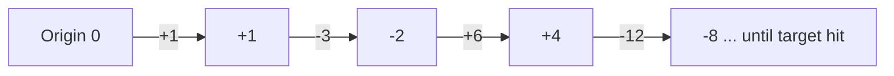

# The Cow-Path Problem (Online Search)

## What it is
An online searcher stands at origin `0` along an infinite 1D corridor looking for a target (a gate in the fence) located at an unknown signed integer distance $d \ne 0$. Without knowing either the direction or $|d|$ in advance, how does an online algorithm minimize its **competitive ratio** against an omniscient offline walk of length $|d|$?

## How it works
* **Doubling spiral search (`cow_path_search`)**: Sweep out alternating directions `+1, -2, +4, -8, ..., (-1)^k 2^k` from the origin until encountering $d$.
* **Why $r = 2$ yields 9-competitiveness**: If the target sits just past $+2^k$ at $d = 2^k + 1$, the cow just returned from $-2^{k+1}$ and walks back to $+d$. Summing the outbound/return legs gives $2(1 + 2 + 4 + \dots + 2^{k+1}) + |d| = 2(2^{k+2} - 1) + |d| < 8|d| + |d| = 9|d|$.
* **Arbitrary geometric factor (`cow_path_search_factor`)**: Sweeping $r^0, r^1, r^2, \dots$ yields worst-case competitive ratio $1 + \frac{2r^2}{r - 1}$, whose global minimum over $r > 1$ occurs uniquely at $r = 2$ (ratio $9$) — which is optimal among all deterministic online algorithms (compare [online caching](#/online_caching) and the [elevator problem](#/elevator)).

## Complexity
* **Total distance walked**: At most $9|d|$ steps for doubling ($r=2$); $O(\lg |d|)$ direction reversals.
* **Computation per step**: $O(1)$ arithmetic.

## When to use it
In online search, robot exploration of unbounded corridors/trees, and iterative deepening thresholds where parameter scales are unknown ahead of time.

## In this implementation
`cow_path_search`, `cow_path_search_factor`, and `theoretical_ratio` verify the strict $\le 9|d|$ invariant exhaustively across all integers $d \in [-10\,000, 10\,000] \setminus \{0\}$ and validate $1 + 2r^2/(r-1)$ across general ratios $r > 1$.
