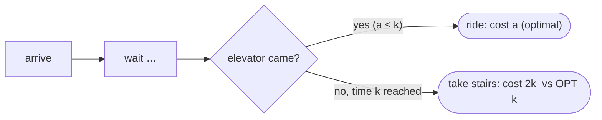

# Waiting for an Elevator (Competitive Analysis)

## What it is
Most algorithms in this book are **offline**: the whole input is known beforehand. An **online algorithm** must make irrevocable decisions as the input arrives, without knowing the future. Chapter 27 of the 4th edition introduces **competitive analysis**: an online algorithm is *`c`-competitive* if for every input its cost is at most `c` times the cost of an optimal offline algorithm (plus a constant). The warm-up is a small, familiar dilemma.

## How it works
You arrive at the lobby and could climb the stairs (extra cost `k`, e.g. the time to walk up) or wait for the elevator, which arrives after an unknown time `a`. An offline algorithm that knows `a` pays `min(a, k)`. The online strategy **"wait up to time `θ`; if the elevator hasn't come, take the stairs"** costs `a` when `a ≤ θ` and `θ + k` otherwise.

* With `θ = k` the worst case is `a` slightly above `k`: the online cost is `2k` versus OPT `k`, a ratio of **2**; for `a ≤ k` the ratio is 1.
* With `θ < k` or `θ > k` the worst ratio is larger (`(θ+k)/θ` or `(θ+k)/k`).
* No deterministic strategy beats 2 (an adversary releases the elevator right after you commit).

This is exactly the **ski-rental problem** (rent for `k` days, or buy) and the same pattern as the [secretary / online hiring](#/online_hiring) problem.

## Complexity
Constant time per decision; competitive ratio 2.

## When to use it
Rent-or-buy decisions, deciding when to power down an idle disk or radio (break-even strategies), TCP-timeout design, and as the entry point to analysing [online caching](#/online_caching).

## In this implementation
The competitive ratio is measured numerically over a fine grid of arrival times, confirming ratio 2 at `θ = k` and strictly worse ratios at other thresholds.
