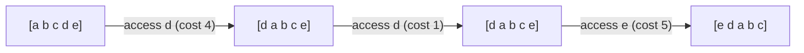

# Self-Organizing Lists: Move-to-Front

## What it is
A **self-organizing list** stores `n` keys in a linked list; searching for the key at position `i` costs `i`. Because accesses are usually *skewed* (a few keys are hot), rearranging the list on the fly can reduce the average cost, even though future requests are unknown. The **move-to-front (MTF)** heuristic moves every accessed element to the head of the list. Section 27.2 of the 4th edition (Problem 17-5 in the 2nd and 3rd) analyses it with competitive analysis.

## How it works
Compare MTF with an arbitrary algorithm `A` (possibly an offline optimum) that serves the *same* request sequence starting from the same list, paying 1 for each transposition of adjacent items. Theorem 27.? : `cost_MTF ≤ 4·cost_A`.

Proof sketch with the **potential method**: let `Φ` = twice the number of **inversions** between MTF's list and `A`'s list (pairs in opposite relative order). Accessing a key `x` with `k` items in front of it in MTF's list, of which `r` also precede it in `A`'s list: MTF pays `k+1`; `A` pays `≥ r+1`. After MTF moves `x` to the front, the inversions change by at least `r − (k−r)`, and so the amortised cost of MTF is `≤ 4(r+1) − 1 ≤ 4·(cost of A on that access)`. Summing over all requests gives the 4-competitive bound (the sequence starts with `Φ = 0` since both lists are equal).

## Complexity
Each access costs its position; the bound holds for every request sequence.

## When to use it
Caching of recent items in small memories, adaptive compression (the **MTF transform** in bzip2 follows a Burrows–Wheeler step), dictionary lookup in text compressors, and as the simplest example of a competitive online algorithm. See also [online caching](#/online_caching).

## In this implementation
`MtfList::access` returns the cost; tests verify the 4-competitive bound against the best *static* ordering (which an offline algorithm could reach with at most `n²` swaps), the speed-up on skewed streams, and the adversarial worst case.
