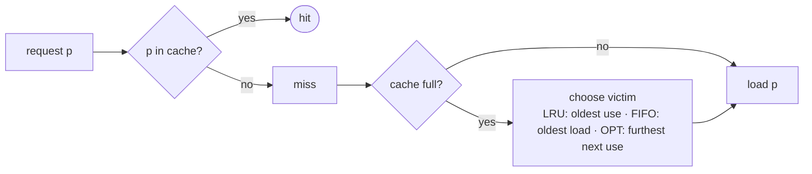

# Online Caching: LRU, FIFO and Belady's Optimum

## What it is
A computer has a small fast **cache** holding `k` pages out of a large slow memory. When a requested page is missing (a **cache miss**) it must be brought in, evicting another page if the cache is full. Which page to evict? An *online* policy does not know future requests; the *offline optimum* does. Section 27.3 of the 4th edition (Problem 16-5 in the 3rd) compares them by **competitive ratio** on the number of misses.

## How it works
* **Furthest-in-future (Belady, 1966)** — evict the page whose next request is farthest away (or never). It is **optimal** (greedy-choice proof by exchange: any other eviction can be swapped for Belady's without adding misses) but needs the future, so it serves as the benchmark.
* **LRU** — evict the least recently used page. **FIFO** — evict the oldest-loaded page. **FWF (flush when full)** — clear the whole cache when a miss finds it full.
* **All three are `k`-competitive** (Theorem 27.?): split the request sequence into *phases* of `k` distinct pages; the policy misses at most `k` times per phase, while any algorithm (even OPT) misses at least once per phase (because a phase together with the first request of the next contains `k+1` distinct pages).
* **No deterministic online policy is better than `k`-competitive**: cycling through `k+1` pages makes LRU and FIFO miss on *every* request while OPT misses only once every `k` requests. (Randomised marking algorithms achieve `O(lg k)`.)

## Complexity
LRU/FIFO `O(1)` per request with hash maps and linked lists (this demo uses lists for clarity); Belady `O(n)` per miss with a naive search.

## When to use it
CPU caches, virtual-memory paging, web/CDN caches, database buffer pools. Real systems use LRU approximations (CLOCK) because LRU performs well on workloads with *locality*, where its real-world miss counts are close to optimal even though the worst-case ratio is `k`. Compare the list version in [move-to-front](#/move_to_front).

## In this implementation
All four policies count misses. Tests verify that Belady equals an exhaustive-search optimum on small instances, that every online policy satisfies `misses ≤ k·OPT`, and that the cyclic adversary forces the ratio toward `k`.
