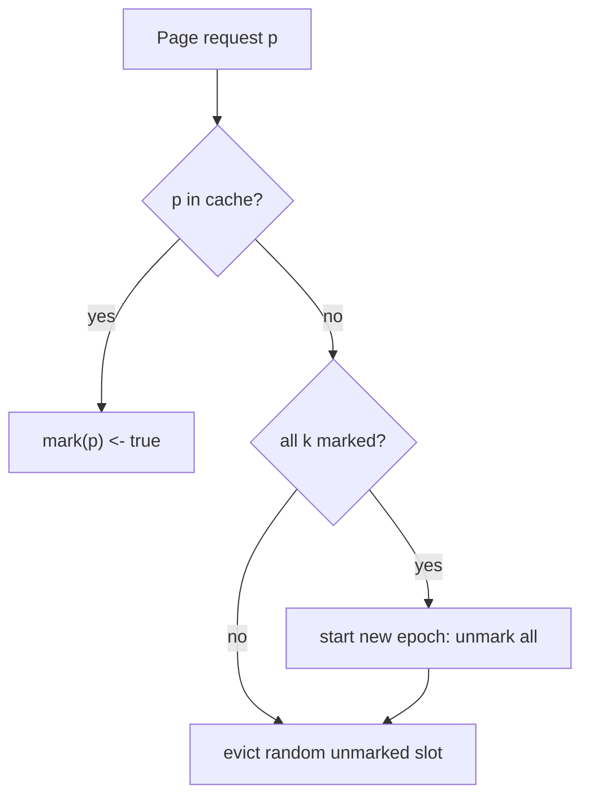

# Randomized Marking for Online Paging

## What it is
Epoch-based paging policies from Section 27.3.2 of the 4th edition: deterministic `MARKING` ($k$-competitive) and `RANDOMIZED-MARKING` ($2 H_k = O(\lg k)$ expected competitive ratio against an oblivious adversary).

## How it works
Each cached page carries a 1-bit `marked` flag initialized to `false` on a cold cache:
1. On a **hit**, set the page's mark to `true`.
2. On a **miss** with a full cache, if every cached slot is already marked, reset all $k$ marks to `false` (beginning a new **epoch**).
3. Evict an **unmarked** page (`RANDOMIZED-MARKING` picks uniformly at random among unmarked slots) and insert the requested page marked.

## Complexity
$O(k)$ per page request in a simple slot array (or $O(1)$ expected with a hash map and unmarked list), strictly matching `belady_misses` offline bounds within $2 H_k$.

## When to use it
Online caching and paging when deterministic policies like [LRU and FIFO](#/online_caching) hit their worst-case $\Theta(k)$ cycle-thrashing bound.

## In this implementation
`marking_misses` and `randomized_marking_misses` simulate deterministic and randomized epoch evictions using `crate::common::Rng`, verifying the $2 H_k$ expected bound against [Belady's optimum](#/online_caching).
