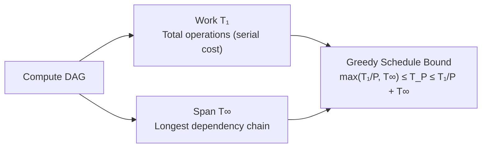

# Parallel Algorithms

## Introduction
Modern CPUs don't get dramatically faster on a single core anymore—instead, they give you 8, 16, or 128 cores. Introduced in CLRS 3rd edition (Ch. 27) and updated in the 4th edition (Ch. 26), **Task-Parallel (Multithreaded) Algorithms** use `spawn` and `sync` keywords to express parallelism cleanly without manually micromanaging thread pools, locks, or race conditions. You analyze algorithms with two numbers instead of one: **Work** ($T_1$, total CPU steps) and **Span** ($T_\infty$, critical-path length if you had infinite cores).

## What Problem Is It Solving?
- **Measuring parallel speedup cleanly:** How fast can a divide-and-conquer algorithm run on $P$ processors? [Brent's Theorem & Greedy Scheduling](#/brent_scheduling) proves $T_P \le T_1/P + T_\infty$, defining **parallelism** as $T_1 / T_\infty$.
- **Fixing serial bottlenecks in familiar algorithms:** Converting sequential loops or two-way merges into shallow trees so $P$ cores actually stay busy ([Parallel Fibonacci](#/p_fib), [Parallel Mat-Vec](#/p_mat_vec), [Parallel Matrix Multiply](#/p_matrix_multiply), [Parallel Merge Sort](#/p_merge_sort), [Parallel Randomized Quicksort](#/p_quicksort), [Parallel Scan, Stencil & LU](#/p_scan_stencil_lu)).

## Algorithms & Trade-Offs

| Algorithm | Work $T_1$ | Span $T_\infty$ | Parallelism ($T_1 / T_\infty$) | Key Trade-Off |
|---|---|---|---|---|
| [Parallel Fibonacci](#/p_fib) | $\Theta(\phi^n)$ | $\Theta(n)$ | Exponential | Great for teaching DAGs, **terrible** algorithm in practice because recursive Fibonacci wastes exponential work. Fast span cannot rescue wasted work! |
| [P-MAT-VEC](#/p_mat_vec) (2 parallel loops) vs. naive race | $\Theta(n^2)$ | $\Theta(\lg n)$ | $\Theta(n^2 / \lg n)$ | Parallelizing the inner sum with a tree/race-free reduction preserves $\Theta(n^2)$ work while dropping span from $\Theta(n)$ to $\Theta(\lg n)$; writing directly to one shared accumulator causes a **determinacy race**. |
| [Parallel Matrix Multiply](#/p_matrix_multiply) (`P-MATRIX-MULTIPLY` vs. `-ADD`) | $\Theta(n^3)$ | $\Theta(\lg^2 n)$ vs. $\Theta(\lg n)$ | $\Theta(n^3 / \lg^2 n)$ | Spawning all 8 quadrants in parallel uses extra temporary matrices ($\Theta(n^3)$ extra memory if naive), while adding serially drops space overhead at the cost of doubling span to $\Theta(\lg^2 n)$. |
| [Parallel Merge Sort](#/p_merge_sort) (serial merge vs. `P-MERGE`) | $\Theta(n \lg n)$ | $\Theta(n)$ vs. $\Theta(\lg^3 n)$ | $\Theta(\lg n)$ vs. $\Theta(n / \lg^2 n)$ | If you sort both halves in parallel *but* use ordinary sequential `MERGE`, the final merge takes $\Theta(n)$ span, killing multi-core speedup beyond $\lg n$ cores! Binary-searching inside `P-MERGE` fixes the bottleneck. |
| [Parallel Scan](#/p_scan_stencil_lu) (Two-Pass Up-Down) | $\Theta(n)$ | $\Theta(\lg n)$ | $\Theta(n / \lg n)$ | Avoids the $\Theta(n \lg n)$ work bloat of naive pointer-jumping scans by doing a binary-tree reduction upward then prefix sweep downward. |

## Quick Rules of Thumb for CS Students
- **Don't lose work-efficiency:** A good parallel algorithm keeps $T_1$ asymptotically close to the best *serial* algorithm while shrinking $T_\infty$ to polylogarithmic ($O(\lg^k n)$).
- **Watch the combine step!** Parallel divide-and-conquer only scales if the *merge/combine* step (like `P-MERGE`) is also parallelized; otherwise Amdahl's Law caps your speedup at the serial combine step.
- **Avoid determinacy races:** Two parallel branches must never read/write the same memory location concurrently unless synchronized, or output changes non-deterministically depending on thread timing.
