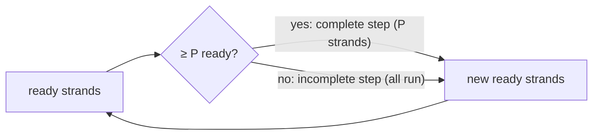

# Greedy Scheduling and Brent's Theorem

## What it is
A multithreaded computation is a DAG of unit-time **strands**. A **scheduler** maps strands to `P` processors. Two lower bounds apply to any scheduler (the **work law** `T_P ≥ T₁/P` and the **span law** `T_P ≥ T∞`), and Theorem 27.1 shows that a simple **greedy scheduler** nearly meets them: `T_P ≤ T₁/P + T∞` (Brent's theorem, 1974). Hence every greedy schedule is within a factor 2 of optimal, and achieves *linear speedup* when the parallelism `T₁/T∞` greatly exceeds `P`.

## How it works
At each time step the greedy scheduler executes as many ready strands (all predecessors finished) as there are processors:
* **complete step** — at least `P` strands are ready, so `P` run;
* **incomplete step** — fewer than `P` are ready, so all of them run.

There are at most `T₁/P` complete steps (each does `P` units of work). Every incomplete step shrinks the remaining span by one (all the strands on a longest remaining path are ready and get executed), so there are at most `T∞` of them. Adding the two bounds gives the theorem. [P-FIB](#/p_fib) and [P-MAT-VEC](#/p_mat_vec) are analysed with these quantities.

## Complexity
Simulation `O(n + e)` per run; the bound itself: `max(T₁/P, T∞) ≤ T_P ≤ T₁/P + T∞`.

## When to use it
Reasoning about speedup of fork-join programs (Cilk, TBB, Rayon): predicts scalability from two numbers and explains why work-stealing schedulers perform well.

## In this implementation
`analyse` returns work, span and the greedy makespan. Tests verify, on 300 random DAGs for `P ∈ {1,2,3,5,100}`, the work and span laws, Theorem 27.1 in integer form, the factor-2 corollary, and that a dependency chain never speeds up.
