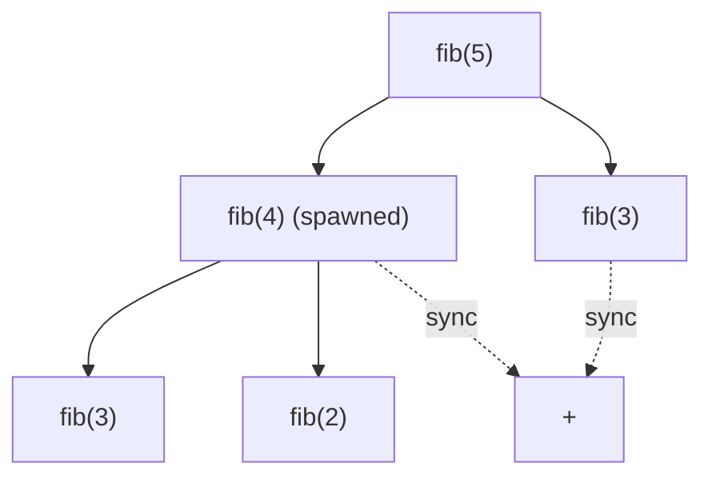

# Parallel Fibonacci & Work-Span Analysis

## What it is
The 3rd edition added a chapter on **multithreaded algorithms** (renamed *Parallel Algorithms* in the 4th), using a simple **dynamic multithreading** model: the programmer states *logical* parallelism with `spawn`, `sync` and `parallel for`; a runtime scheduler maps it to processors. `P-FIB` is the introductory example.

## How it works
```
P-FIB(n):                                   parent
  if n ≤ 1: return n                          │
  x = spawn P-FIB(n-1)   ← may run in parallel│ ╲
  y = P-FIB(n-2)                              │  child
  sync                   ← wait for children  │ ╱
  return x + y
```
The execution is a **computation DAG** of strands. Two measures describe it:
* **Work** `T₁` — total time on one processor (number of vertices).
* **Span** `T∞` — time on unlimited processors (longest path, the *critical path*).

Laws: `T_P ≥ T₁/P` (work law) and `T_P ≥ T∞` (span law). The **parallelism** `T₁/T∞` is the maximum possible speedup. For P-FIB: `T₁(n) = Θ(φⁿ)`, `T∞(n) = Θ(n)`, so parallelism is `Θ(φⁿ/n)` — enormous. A greedy scheduler achieves `T_P ≤ T₁/P + T∞`.



## Complexity
Work Θ(φⁿ), span Θ(n). (Computing Fibonacci this way is *terrible* work-wise — an O(lg n) algorithm exists — it is only used to illustrate the model.)

## When to use it
Thinking about any fork–join program (Cilk, Rayon, Java `ForkJoinPool`, OpenMP tasks): estimate work and span to predict scalability. See also [parallel merge sort](#/p_merge_sort) and [parallel matrix multiplication](#/p_matrix_multiply).

## In this implementation
`spawn`/`sync` are `std::thread::scope` + `join`; below a cutoff the recursion runs serially. `work(n)` and `span(n)` evaluate the recurrences exactly (work = `2F(n+1) − 1`, span = `n`).
