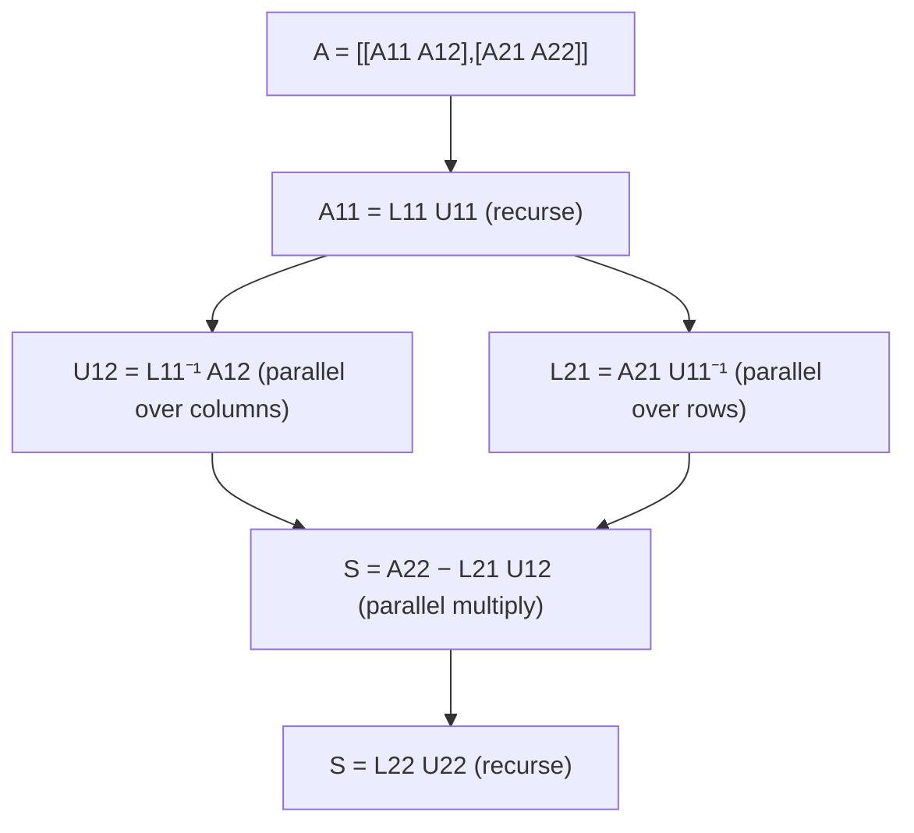

# Multithreaded Matrix Algorithms: Transpose and LU Decomposition

## What it is
Problem 27-3 extends the multithreaded matrix algorithms of Section 27.2 ([P-MATRIX-MULTIPLY](#/p_matrix_multiply)) to other basic operations: **in-place transposition** and **LU decomposition** (and, in the original, the LUP and Cholesky variants). It is where the fork-join model meets the divide-and-conquer decompositions of [Chapter 28](#/lup_decomposition).

## How it works
* **P-TRANSPOSE.** For a matrix split into quadrants, `Aᵀ` has `A₁₁ᵀ` and `A₂₂ᵀ` on the diagonal and the two off-diagonal quadrants *exchanged and transposed*. Transpose `A₁₁` and `A₂₂` in parallel, and exchange `A₁₂` with `A₂₁ᵀ` by a recursive procedure that splits each block into four and recurses on the four independent pairs. All recursive calls at one level are independent, so the span is `T(n) = T(n/2) + Θ(lg n)`-ish, here `Θ(lg n)`, with work `Θ(n²)`.
* **Recursive LU.** Write `A = [[A₁₁, A₁₂],[A₂₁, A₂₂]]`. Factor `A₁₁ = L₁₁U₁₁` recursively; then compute `U₁₂ = L₁₁⁻¹A₁₂` (one forward substitution per column — columns are independent, so a `parallel for`) and `L₂₁ = A₂₁U₁₁⁻¹` (one back substitution per row — also parallel); form the Schur complement `S = A₂₂ − L₂₁U₁₂` with a parallel matrix multiplication and recurse on `S`. The decomposition is *blocked*: almost all the work is in matrix multiplication, which parallelises perfectly — the reason high-performance LU libraries are organised this way.

## Complexity
Transpose: work `Θ(n²)`, span `Θ(lg n)`. LU: work `Θ(n³)`; the span is dominated by the *sequential chain* of recursive factorisations, `Θ(n lg n)`-class for this scheme (the problem asks you to derive it), so LU is much less parallel than matrix multiplication.

## When to use it
Dense linear solvers (LAPACK's `getrf` and ScaLAPACK are blocked right-looking LU), in-place transposition in FFT and image libraries, and cache-oblivious matrix code.

## In this implementation
The recursion is executed sequentially; `p_transpose` returns the recursion depth (the span proxy). Tests transpose every power-of-two size up to 32 and check the depth is logarithmic, and check `A = LU` with unit lower and upper triangular factors on 100 random strictly diagonally dominant matrices of sizes 1–11 (no pivoting needed).
