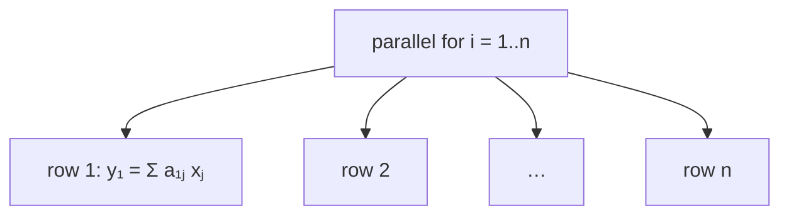

# Parallel Matrix-Vector Product (P-MAT-VEC)

## What it is
Section 27.1 introduces the **fork-join** model with `spawn`, `sync` and `parallel for`. Its second example multiplies an `n × n` matrix by a vector: the `n` entries of `y = Ax` are independent, so the loop over rows can be a **`parallel for`**. It is the standard first example of analysing a program by its **work** `T₁`, **span** `T∞` and **parallelism** `T₁/T∞` (compare [P-FIB](#/p_fib)).

## How it works
A `parallel for` over `n` iterations is compiled into a binary tree of spawns of depth `lg n`, so its span is `Θ(lg n)` plus the span of one iteration. For P-MAT-VEC:
* **work** `T₁ = Θ(n²)` — the same as the serial algorithm;
* **span**: `Θ(lg n)` to launch the rows, plus `Θ(n)` for a serial dot product → `Θ(n)`; parallelism `Θ(n)`. If each row sum is itself a parallel reduction tree, the span drops to `Θ(lg n)`, parallelism `Θ(n²/lg n)`.

**Determinacy races.** Making *both* loops parallel with every iteration doing `y[i] += a[i][j]·x[j]` is **wrong**: two strands may read the same old value of `y[i]`, and one update is lost (Exercise 27.1 asks you to spot this). Each parallel strand must write only to locations no concurrently running strand touches.

## Complexity
`T₁ = Θ(n²)`, `T∞ = Θ(n)` (or `Θ(lg n)` with reductions), by the work law `T_P ≥ T₁/P` and span law `T_P ≥ T∞`, speedup is limited by the parallelism.

## When to use it
Basic building block of dense linear algebra and neural-network inference; the same row-partitioning pattern drives GPU kernels and [parallel matrix multiplication](#/p_matrix_multiply).

## In this implementation
Rows are divided among `std::thread::scope` workers (`chunks_mut` makes writes disjoint, so no race is possible). Tests check the result against the serial product for 1–100 workers, and the span formulas; the racy accumulator shows a lost update (4 instead of 10).
