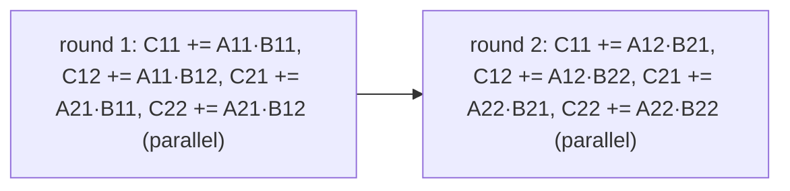

# Saving Temporary Space in Matrix Multiplication

## What it is
The multithreaded recursive matrix multiplication of Section 27.2 ([P-MATRIX-MULTIPLY-RECURSIVE](#/p_matrix_multiply)) computes all eight half-size products in parallel into **two** result matrices — hence it allocates a temporary `n × n` matrix `T` and adds `C + T` at the end. This costs `Θ(n²)` extra space at every level (and allocation time). Problem 27-2 explores the opposite trade-off: a version that needs **no temporary** at the price of more sequencing.

## How it works
Eight products are needed: `C_ij = A_i1·B_1j + A_i2·B_2j`. Two products that update the same quadrant `C_ij` cannot safely run at the same time — they would race on the same entries. So do it in **two rounds of four**: in round 1 compute `C_ij += A_i1·B_1j` for the four quadrants in parallel (they write different quadrants), then in round 2 `C_ij += A_i2·B_2j`. Each recursive call accumulates directly into `C`.

* **Work:** `T₁(n) = 8T₁(n/2) + Θ(1) = Θ(n³)`.
* **Span:** `T∞(n) = 2T∞(n/2) + Θ(1) = Θ(n)` — two sequential rounds per level, versus `Θ(lg² n)` for the version with a temporary (one parallel round of eight products plus a parallel addition of depth `lg n`).
* **Parallelism:** `Θ(n²)` instead of `Θ(n³/lg² n)` — still plenty for any realistic machine, which is why the space-saving variant is the better engineering choice when `n` is large.

## Complexity
Work `Θ(n³)`, span `Θ(n)`, extra space `0` (beyond the stack); with a temporary: span `Θ(lg² n)`, extra space `Θ(n²)`.

## When to use it
Memory-bound dense linear algebra (GEMM in BLAS libraries is organised in exactly such accumulate-into-C rounds) and any parallel divide-and-conquer where parallelism is abundant and storage is not.

## In this implementation
Executed sequentially with an exact span accounting (the longest of the four products in each round, summed over the two rounds). Tests compare with the naive product for sizes `1…32` and check that the span is exactly `n` (the recurrence `T(n) = 2T(n/2) + 1` with `T(1) = 1`).
