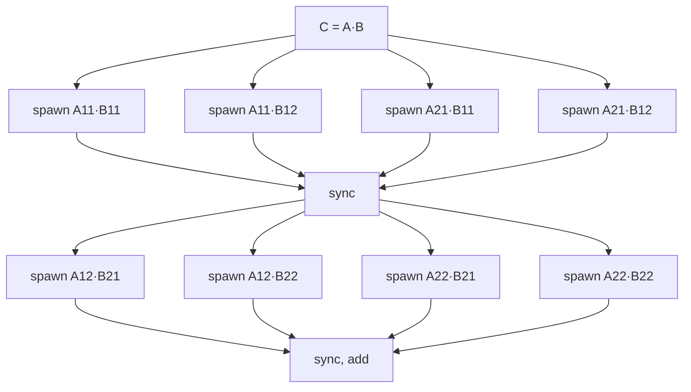

# Parallel Matrix Multiplication

## What it is
Section 27.2 (26.2 in the 4th edition) applies the work/span model to matrix algorithms, using the keyword **`parallel for`** (loop iterations may run concurrently) in addition to `spawn` and `sync`.

## How it works
* **P-MAT-VEC** — compute `y = Ax`; the iterations of the outer loop are independent, so they run as a `parallel for`. Work `Θ(n²)`, span `Θ(lg n)` for the loop control plus `Θ(n)` for each serial inner loop ⇒ `Θ(n)` unless the inner summation is also parallelised.
* **P-SQUARE-MATRIX-MULTIPLY** — parallelise the two outer loops over `i` and `j`; keeping the innermost `k` loop serial avoids a *determinacy race* on `c[i][j]`. Work `Θ(n³)`, span `Θ(n)`, parallelism `Θ(n²)`.
* **P-MATRIX-MULTIPLY-RECURSIVE** — the divide-and-conquer algorithm of [Chapter 4](#/matrix_multiply) with `spawn`ed half-size products (first four, sync, then the other four so they don't race on the same quadrant of `C`). Work `Θ(n³)`, span `Θ(lg² n)`, parallelism `Θ(n³/lg² n)` — more than the loop version.

## Complexity
Work Θ(n³) for all versions (Strassen's variant has work `Θ(n^lg 7)` and span `Θ(lg² n)`); the span differs as stated.

## When to use it
Dense linear algebra on multicore CPUs; the same decomposition drives cache-oblivious and GPU tiled kernels. Avoid *determinacy races* — two logically parallel strands accessing the same location with at least one write.

## In this implementation
Row blocks go to `std::thread::scope` workers (disjoint `chunks_mut` ⇒ safe Rust prevents races by construction); the recursive version spawns eight tasks and combines. All variants equal the serial product.
