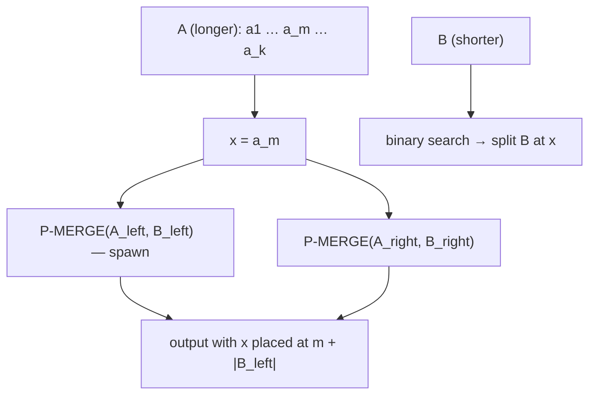

# Parallel Merge Sort

## What it is
[Merge sort](#/merge_sort) parallelises naturally: the two recursive calls are independent. But the serial `MERGE` takes Θ(n) time, which caps the span at Θ(n) and the parallelism at Θ(lg n). Section 27.3 (26.3 in the 4th edition) fixes this with a **parallel merge**.

## How it works
**P-MERGE** (merging sorted arrays `T[p₁..r₁]` and `T[p₂..r₂]`, assuming the first is the longer):
1. Take the median `x = T[q₁]` of the longer array.
2. **Binary-search** the shorter array for the position `q₂` where `x` would be inserted.
3. Write `x` directly to its final position `q₁ + q₂` in the output.
4. **Spawn** a recursive P-MERGE for everything smaller than `x`, run the other for everything larger, and **sync**.

Because the median splits the longer array in half, each subproblem has at most `3n/4` elements, giving `T∞(n) = Θ(lg² n)` for the merge and `Θ(n)` work.

**P-MERGE-SORT** spawns the two halves, then calls P-MERGE: `T∞(n) = Θ(lg³ n)`, work `Θ(n lg n)`, parallelism `Θ(n / lg² n)`.

## Complexity
Work Θ(n lg n); span Θ(lg³ n); parallelism Θ(n/lg² n).

## When to use it
Large sorts on multicore machines (e.g. Rust `rayon::par_sort`, Java `Arrays.parallelSort`). The recursion's disjoint output halves (`split_at_mut`) make it data-race free.

## In this implementation
`p_merge` follows the median/binary-search recipe with a serial base case of 2048 elements; `p_merge_sort` uses `thread::scope` and falls back to the serial [merge sort](#/merge_sort). Tests cross-check against `slice::sort` including skewed merge sizes.
