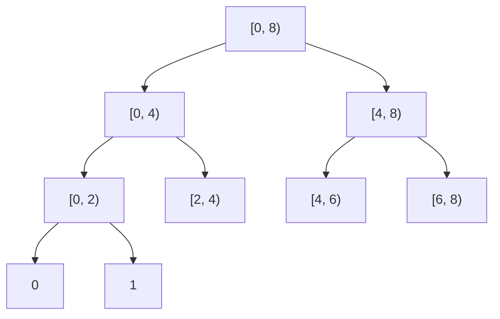

# Implementing Parallel Loops with Nested Parallelism

## What it is
The pseudocode of [Chapter 27](#/p_fib) has a `parallel for` keyword, but the machine model only has `spawn` and `sync`. Problem 27-1 asks how a `parallel for` can be built from them and what each implementation costs in work and **span**. It also raises the question of the *grain size*: how many iterations should one strand run serially?

## How it works
* **Naive:** `for i = 1 to n: spawn BODY(i); sync`. The parent strand must execute `n` spawns *one after another*, so the span is `Θ(n)` — a loop of a million iterations cannot finish faster than a million spawn steps even on a million processors.
* **Nested parallelism (divide and conquer):** `PARALLEL-FOR(lo, hi)`: if the range is a single iteration run it; otherwise `spawn PARALLEL-FOR(lo, mid)`, call `PARALLEL-FOR(mid, hi)`, `sync`. The spawns form a **balanced binary tree**, so the span is `Θ(lg n)` plus the span of one iteration. This is how Cilk's `cilk_for` is compiled.
* **Grain size `g`.** The tree has `n/g` leaves, each running `g` iterations serially: span `Θ(lg(n/g) + g)`. Spawn overhead is paid `Θ(n/g)` times instead of `Θ(n)`, which is vital in practice. With `g = Θ(lg n)` the span is still `Θ(lg n)` while the number of spawns drops by a `lg n` factor.

## Complexity
Work `Θ(n)` plus spawn overhead; span `Θ(lg n)` with nested parallelism, `Θ(n)` for the naive loop, `Θ(lg(n/g) + g)` with grain `g`.

## When to use it
Every fork-join runtime (Cilk, OpenMP's `parallel for` with `schedule(static, g)`, Rayon's `par_iter` with `with_min_len`) does this; understanding it explains why tiny loop bodies should be batched.

## In this implementation
`parallel_for` spawns scoped threads by recursive halving and returns the depth of the spawn tree. Tests check that every index runs exactly once for sizes 0–1000 and grains 1–5000, that the spawn depth is at most `⌈lg n⌉`, and the span formulas (nested vs. naive).
