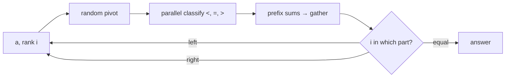

# Multithreaded Randomized Select

## What it is
[RANDOMIZED-SELECT](#/randomized_select) finds the `i`-th smallest element in expected linear time by partitioning around a random pivot and recursing into one side only. Problem 27-6 (randomized multithreaded algorithms) covers its parallelisation together with that of [P-QUICKSORT](#/p_quicksort); randomness needs care in multithreaded programs, since each strand would otherwise need its own reproducible random stream.

## How it works
The recursion is a loop (only one side survives), so all parallelism lies in the **partition**:
1. Choose a random pivot.
2. Classify the elements as `<`, `=`, `>` the pivot **in parallel** — chunks go to different workers.
3. Turn the three per-chunk counts into output positions with a [parallel prefix computation](#/p_reduce_scan) and copy elements into their slots (here: concatenation of the per-chunk pieces in order).
4. Continue with the side that contains rank `i`.

* **Work:** expected `Θ(n)` — a geometric series, as for the serial algorithm.
* **Span:** one partition has span `Θ(lg n)` with a parallel prefix; the expected number of rounds is `Θ(lg n)` (the subproblem shrinks by a constant factor in expectation), so the expected span is **`Θ(lg² n)`**, parallelism `Θ(n/lg² n)`.
* Randomness: a single generator is used sequentially for the pivots (the only random choices), which keeps results reproducible whatever the number of workers.

## Complexity
Expected work `Θ(n)`, expected span `Θ(lg² n)`.

## When to use it
Parallel order statistics: medians for splitting data across workers (sample sort pivots), percentile queries on large arrays, and quickselect in database engines.

## In this implementation
`p_partition` spawns scoped threads over chunks; subarrays under 2 000 elements are partitioned on one thread. Tests compare the result with sorting on 100 random arrays (with many duplicates in half of them) for 1, 3 and 8 workers, and check the partition invariants and that 100 000 elements need fewer than 80 recursion rounds.
