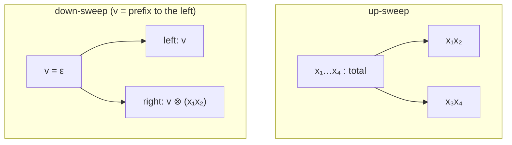

# Multithreading Reductions and Prefix Computations

## What it is
A **reduction** combines `x₁ ⊗ x₂ ⊗ … ⊗ x_n` for an associative operator `⊗`; a **scan** (prefix computation) produces *all* prefixes `y_i = x₁ ⊗ … ⊗ x_i`. Both are building blocks of parallel programming (sums, running maxima, stream compaction, radix sort, carry computation in adders). Problem 27-4 asks you to analyse a reduction and three scan algorithms in the work/span model of [Chapter 27](#/brent_scheduling). (The PRAM version is [parallel prefix](#/parallel_prefix).)

## How it works
* **P-REDUCE.** Reduce the two halves with parallel strands, combine the results: work `Θ(n)`, span `Θ(lg n)`.
* **P-SCAN-1.** Compute each prefix with its own reduction, in a parallel for: work `Θ(n²)`, span `Θ(lg n)` — fast but wasteful.
* **P-SCAN-2.** Scan both halves recursively in parallel, then `parallel for` over the right half to prepend the left half's total: work `T(n) = 2T(n/2) + Θ(n) = Θ(n lg n)`, span `T(n) = T(n/2) + Θ(lg n) = Θ(lg² n)`.
* **P-SCAN-3 (work-efficient).** *Up-sweep:* a tree reduction that remembers the total of every left subtree. *Down-sweep:* each node passes down `v` = the combination of everything to its left; the right child gets `v ⊗ (left total)`. Work `Θ(n)`, span `Θ(lg n)` — optimal.
None of the algorithms assumes `⊗` is commutative (only associativity), which the tests check with string concatenation.

## Complexity
| algorithm | work | span |
|---|---|---|
| P-SCAN-1 | Θ(n²) | Θ(lg n) |
| P-SCAN-2 | Θ(n lg n) | Θ(lg² n) |
| P-SCAN-3 | Θ(n) | Θ(lg n) |

## When to use it
Stream compaction and filtering on GPUs, parallel sorting, lexical analysis, evaluating linear recurrences, and big-integer carry propagation; the Blelloch scan (P-SCAN-3) is in every GPU library.

## In this implementation
`p_reduce` uses scoped threads. The three scans are executed sequentially but carry an exact **cost model** (operator applications as work, recursion depth as span), so their asymptotics are checkable. Tests verify equality with the serial prefix on 100 random integer arrays and on string concatenation, and that work and span grow as in the table.
