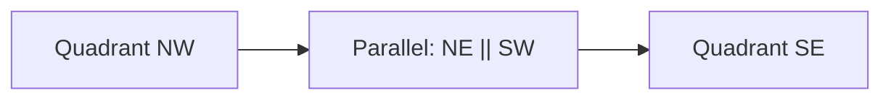

# Parallel Scan, 2D Stencil & Parallel LU

## What it is
Three canonical divide-and-conquer parallel algorithms from the multithreaded algorithms chapter (extending [parallel matrix multiplication](#/p_matrix_multiply)):
1. **`P-SCAN` (`p_scan`)**: Work-efficient two-pass parallel prefix sum in $\Theta(n)$ work and $\Theta(\lg n)$ span.
2. **2D Stencil Wavefront (`p_stencil_lcs`)**: Quadrant-recursive dynamic programming for grid dependencies like [longest common subsequence](#/lcs) in $\Theta(n^2)$ work and $\Theta(n^{\lg 3})$ span.
3. **Parallel Block LU (`p_block_lu`)**: Recursive Schur-complement block factoring of [LU decomposition](#/lup_decomposition) in $\Theta(n^3)$ work and $\Theta(n \lg n)$ (or $\Theta(n \lg^2 n)$) span.

## How it works
* **`p_scan`**: Builds a balanced binary reduction tree (`up`) computing subtree totals in parallel, then propagates left-sibling prefix offsets downward (`down`) in parallel to write every inclusive prefix in $2 \lg n$ span.
* **`p_stencil_lcs`**: Splits an $m \times n$ DP rectangle into quadrants `(NW, NE, SW, SE)`. First computes `NW`, then launches **`NE` and `SW` in parallel** (neither reads the other's outputs), and finally computes `SE`.
* **`p_block_lu`**: Factors $A_{11} = L_{11} U_{11}$, solves $L_{11} U_{12} = A_{12}$ and $L_{21} U_{11} = A_{21}$ concurrently, updates Schur complement $S = A_{22} - L_{21} U_{12}$, and recurses on $S$.

## Complexity
| Algorithm | Work $T_1$ | Span $T_\infty$ |
|---|---|---|
| `p_scan` | $\Theta(n)$ | $\Theta(\lg n)$ |
| `p_stencil_lcs` | $\Theta(mn)$ | $\Theta(n^{\lg 3})$ |
| `p_block_lu` | $\Theta(n^3)$ | $O(n \lg n)$–$O(n \lg^2 n)$ |

## When to use it
Whenever multithreaded shared-memory runtimes need prefix reductions without quadratic span, parallel DP tables, or dense factorizations decomposed into independent block matrix operations.

## In this implementation
`p_scan`, `p_stencil_lcs`, and `p_block_lu` record explicit deterministic `WorkSpan` metrics alongside scoped threads and verify bit-exact agreement with sequential prefix sums, LCS DP, and `lu_decomposition`.
