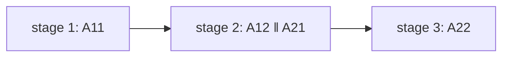

# Multithreading a Simple Stencil Calculation

## What it is
A **stencil computation** updates every cell of an array from its neighbours. Here the `n × n` array `A` has its first row and column given and `A[i][j] = f(A[i−1][j], A[i][j−1], A[i−1][j−1])` for the rest (the dependence pattern of [LCS](#/lcs), [edit distance](#/edit_distance) and the Smith–Waterman table). Problem 27-5 asks how well it can be parallelised. The serial algorithm has work `Θ(n²)`.

## How it works
* **Naïve parallel loops are wrong:** making both loops `parallel for` evaluates a cell before the cells it depends on — a *determinacy race*. Rows can't be parallel; neither can columns.
* **Wavefront:** all cells on an anti-diagonal `i + j = k` are independent; processing the `2n − 1` anti-diagonals in order gives span `Θ(n)`, but a recursive, cache-friendly formulation is the interesting one.
* **Recursive 2×2 blocks (P-STENCIL-2).** Split into quadrants: compute `A₁₁`, then `A₁₂` and `A₂₁` in parallel, then `A₂₂`: work `Θ(n²)` and span `T(n) = 3T(n/2) + Θ(1) = Θ(n^{lg 3}) ≈ n^{1.585}` — three sequential stages.
* **b × b blocks.** Wavefront over the blocks: `2b − 1` stages, each stage's blocks parallel: span `T(n) = (2b−1)·T(n/b) + Θ(1) = Θ(n^{log_b(2b−1)})`. As `b` grows the exponent `log_b(2b−1) = 1 + log_b(2 − 1/b)` tends to **1**, so for every `ε > 0` a large enough `b` gives span `O(n^{1+ε})`. (The problem's final part gets `Θ(n lg n)`-type bounds with a smarter divide and conquer.)

## Complexity
Work `Θ(n²)`; span `Θ(n^{log_b(2b−1)})` (`n^{1.585}` for `b = 2`, `n^{1.465}` for `b = 3`, …).

## When to use it
Dynamic programming tables, Gauss–Seidel relaxation, heat-equation solvers and image filters — cache-oblivious recursive stencils are widely used for exactly this reason.

## In this implementation
The blocks are evaluated in a dependency-respecting order (sequentially), with the span measured as the sum over stages of the longest block in each stage. Tests check that the blocked result equals the serial stencil for ten shapes and block counts (including sizes that are not powers of `b`), that the span stays between half of and equal to `(2b−1)^k` for `n = b^k`, and that larger blocks give shorter spans.
