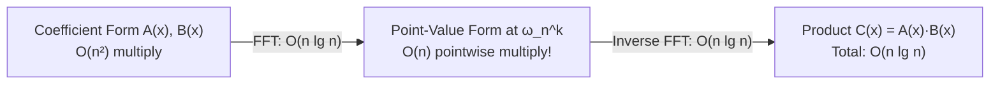

# Polynomials & FFT

## Introduction
Multiplying two $n$-digit numbers or two degree-$n$ polynomials the way you learned in elementary school takes $\Theta(n^2)$ steps. **Chapter 30 of CLRS** (`Ch. 32` in 1e) shows one of the cleanest "magic tricks" in all of algorithms: the **Fast Fourier Transform (FFT)**. By switching briefly from **coefficient representation** to **point-value representation** at the complex roots of unity, FFT slashes polynomial multiplication (convolution) from $\Theta(n^2)$ down to $\Theta(n \lg n)$—powering audio/image compression, signal processing, big-integer arithmetic, and fast algebra.

## What Problem Is It Solving?
- **Fast polynomial & integer multiplication:** Multiply degree-$n$ polynomials or huge integers faster than $\Theta(n^2)$ ([Karatsuba Multiplication](#/karatsuba), [Polynomial Multiplication via FFT](#/polynomial_multiplication)).
- **Evaluating & interpolating at $n$ points fast:** Convert between coefficients and values at $n$ points in $O(n \lg n)$ instead of $O(n^2)$ ([Recursive FFT](#/fft_recursive), [Iterative FFT](#/fft_iterative), [Lagrange Interpolation](#/lagrange_interpolation)).
- **Exact integer convolution without floating-point error:** Replace complex sines/cosines with modular arithmetic over a prime field ([Number-Theoretic Transform (NTT)](#/number_theoretic_transform)).
- **Fast structured linear algebra & calculus:** Multiply Toeplitz matrices in $O(n \lg n)$ ([Toeplitz Multiply](#/toeplitz_multiply)), compute all $n$ derivatives at a point in $O(n \lg n)$, or evaluate at *arbitrary* points in $O(n \lg^2 n)$ ([Multipoint Evaluation & Derivatives](#/multipoint_eval_derivatives)).

## Algorithms & Trade-Offs

| Method | Complexity | Domain / Arithmetic | Key Trade-Off |
|---|---|---|---|
| **Schoolbook Multiplication** vs. [Karatsuba](#/karatsuba) vs. [FFT](#/polynomial_multiplication) | $\Theta(n^2)$ vs. $\Theta(n^{\lg 3}) \approx \Theta(n^{1.585})$ vs. $\Theta(n \lg n)$ | Any ring vs. $\mathbb{C}$ / NTT prime | Schoolbook wins for tiny polynomials ($n < 32$); Karatsuba wins at medium sizes with simple integer arithmetic and zero roots-of-unity setup; FFT wins asymptotically for large $n$. |
| [Recursive FFT](#/fft_recursive) vs. [Iterative FFT](#/fft_iterative) | Both $\Theta(n \lg n)$ | Complex floats $\mathbb{C}$, $n = 2^k$ | Recursive FFT is ~15 lines and crystal clear to read, **but** allocates temporary half-arrays at every level; Iterative FFT swaps into bit-reversed order in place for cache-friendly, zero-allocation butterfly loops (dropped in 4e, kept here!). |
| **Complex FFT** vs. [Number-Theoretic Transform (NTT)](#/number_theoretic_transform) | Both $\Theta(n \lg n)$ | `f64` complex vs. exact `mod p` integers | Complex FFT suffers rounding error (`1e-12` noise requiring rounding back to ints), **whereas** NTT gives 100% exact integer results by using a primitive $n$-th root modulo a prime $p = c \cdot 2^k + 1$ (e.g., `998244353`). |
| [Lagrange / Horner](#/lagrange_interpolation) vs. [Subproduct-Tree Multipoint Eval](#/multipoint_eval_derivatives) | $\Theta(n^2)$ vs. $O(n \lg^2 n)$ | Arbitrary distinct $x_0, \dots, x_{n-1}$ | FFT only evaluates at *roots of unity*. If you need $A(x)$ at $n$ arbitrary points, Horner takes $\Theta(n^2)$ while subproduct-tree remaindering achieves $O(n \lg^2 n)$ (worth it only for larger $n$ due to poly-division constants). |
| [Toeplitz Matrix-Vector](#/toeplitz_multiply) vs. Dense Mat-Vec | $O(n \lg n)$ vs. $\Theta(n^2)$ | Constant-diagonal matrices | Rewriting a Toeplitz product as a padded polynomial convolution lets FFT multiply an $n \times n$ matrix in quasi-linear time! |

## Quick Rules of Thumb for CS Students
- **Convolution = Polynomial Multiplication = Signal Filtering:** Whenever two sequences slide past each other (`c[k] = sum_j a[j] b[k-j]`), you're staring at polynomial multiplication—use FFT!
- **Power-of-two padding:** Standard radix-2 FFT expects length $n$ to be a power of 2; to multiply two degree-$d$ polynomials without wraparound aliasing, pad both arrays with zeros to length $\ge 2d + 1$ rounded up to the next power of 2.
- **Exact integers? Reach for NTT:** Any time exact integer polynomial coefficients matter (big-int libraries, competitive programming, lattices), [NTT](#/number_theoretic_transform) beats complex floating-point FFT on precision.
