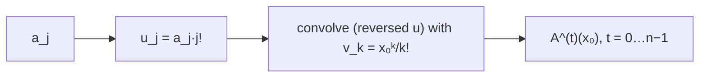

# Evaluating All Derivatives of a Polynomial at a Point

## What it is
For `A(x) = Σ_{j=0}^{n−1} a_j xʲ` and a point `x₀`, compute the values of **all** derivatives `A(x₀), A′(x₀), …, A^(n−1)(x₀)`. Equivalently, compute the **Taylor expansion** `A(x₀ + y) = Σ_t [A^(t)(x₀)/t!] yᵗ` — the polynomial `A` *shifted* by `x₀`. Problem 30-4 asks for an `O(n lg n)` algorithm; repeated [Horner evaluation](#/horner) plus differentiation costs `O(n²)`.

## How it works
Differentiating `t` times and substituting gives

`A^(t)(x₀) = Σ_{j≥t} a_j · j!/(j−t)! · x₀^{j−t} = Σ_{j≥t} (a_j j!) · (x₀^{j−t}/(j−t)!)`.

Put `u_j = a_j · j!` and `v_k = x₀ᵏ/k!`. Then `A^(t)(x₀) = Σ_j u_j v_{j−t}` is a **correlation** of `u` and `v`: reverse `u` and the sums become the coefficients of an ordinary polynomial product. One fast convolution ([FFT](#/polynomial_multiplication) / [NTT](#/number_theoretic_transform)) gives *all* derivatives at once. Here arithmetic is modulo `998 244 353` so that the factorial inverses exist and the result is exact.

## Complexity
`O(n lg n)` versus `O(n²)` for the naive method.

## When to use it
Taylor shifts `A(x) → A(x + c)` (needed to translate polynomials, to isolate roots by Descartes' rule, in computer algebra), computing coefficients of composed polynomials, and combinatorial counting with generating functions.

## In this implementation
Tests compare with the `O(n²)` reference on 150 random polynomials with full-range coefficients modulo `998 244 353` and check the small example `1 + 2x + 3x² + 4x³` at `x₀ = 2` → `[49, 62, 54, 24]`.
