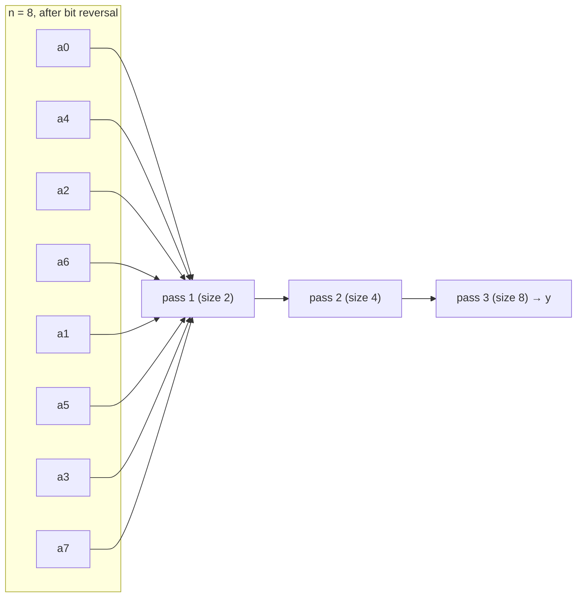

# Iterative FFT (Bit-Reversal Butterflies)

## What it is
The [recursive FFT](#/fft_recursive) allocates new arrays at each level. Unrolling the recursion shows the data flow is a regular network of **butterfly operations**, so the transform can be done **in place** with three nested loops. Section 30.3 (1st–3rd editions; removed from the 4th) presents the iterative form because it maps directly onto hardware: a fixed pipeline of `lg n` stages — the same observation that motivates FPGA FFT cores.

## How it works
1. **BIT-REVERSE-COPY**: the leaf order of the recursion tree is the *bit-reversal permutation* (`rev(k)` reverses the `lg n` bits of `k`), so copy `a[k]` to `A[rev(k)]`.
2. For pass `s = 1 … lg n`, combine adjacent FFTs of size `m/2` (with `m = 2ˢ`) into FFTs of size `m`: for each block start `k` and offset `j < m/2` apply the butterfly
   `t = ωₘʲ · A[k+j+m/2];  u = A[k+j];  A[k+j] = u + t;  A[k+j+m/2] = u − t`.

## Complexity
Θ(n lg n) time with `(n/2)·lg n` butterflies; Θ(1) auxiliary space beyond the permutation.

## When to use it
The standard formulation in numerical libraries, DSP chips and RTL: each stage is a bank of independent butterflies (parallel), the twiddle factors `ωₘʲ` can be stored in a ROM, and the bit-reversal can be absorbed into addressing.

## In this implementation
`rev` reverses bits with `usize::reverse_bits`; the output matches the recursive implementation for all sizes up to 512 and inverts correctly.
