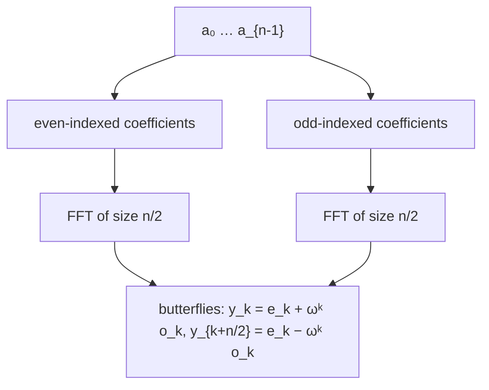

# Fast Fourier Transform (Recursive)

## What it is
A polynomial `A(x) = a₀ + a₁x + … + a_{n−1}x^{n−1}` can be represented by its **coefficients** or by its values at `n` distinct points (**point-value form**). Multiplying polynomials is trivial (pointwise) in point-value form, so if we can convert quickly between forms, multiplication drops from `Θ(n²)` to `Θ(n lg n)`. The **Discrete Fourier Transform** evaluates `A` at the `n` complex `n`-th roots of unity `ωₙ^k = e^{2πik/n}`, and the **FFT** computes it in `Θ(n lg n)`.

## How it works
Split into even and odd coefficients: `A(x) = A_even(x²) + x·A_odd(x²)`. The squares of the `n` roots of unity are just the `n/2` roots of unity of half the order (the **halving lemma**), so two half-size DFTs suffice. With `y⁰ = DFT(a_even)` and `y¹ = DFT(a_odd)`:

`y_k = y⁰_k + ωₙ^k y¹_k`,  `y_{k+n/2} = y⁰_k − ωₙ^k y¹_k`  (the **butterfly**).

The recurrence `T(n) = 2T(n/2) + Θ(n)` gives `Θ(n lg n)`. The **inverse DFT** uses `ωₙ⁻¹` and divides by `n` (the DFT matrix inverse, a Vandermonde matrix at roots of unity, has this simple form — the *summation lemma*).

## Complexity
Θ(n lg n) time, Θ(n lg n) space for this recursive version (Θ(n) for in-place [iterative](#/fft_iterative)).

## When to use it
Fast polynomial and big-integer [multiplication](#/polynomial_multiplication), convolution and correlation, spectral analysis (audio, images), solving PDEs, and signal filtering — hailed as one of the most important algorithms of the 20th century.

## In this implementation
A small `Complex` type, `fft` with an `invert` flag, and an `O(n²)` `dft_naive` for cross-checking. Tests verify equality with the definition for sizes 1…128, round trips, and the 4-point example `A(1)=10, A(i)=−2−2i, …`.
