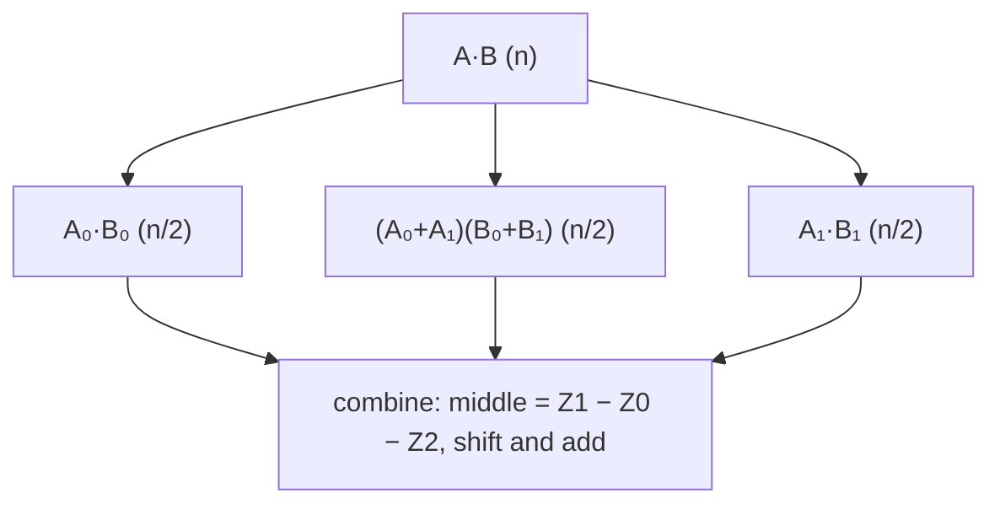

# Karatsuba Multiplication

## What it is
The schoolbook method multiplies two `n`-term polynomials (or `n`-digit numbers) with `n²` scalar multiplications. In 1960 Karatsuba noticed that three half-size products are enough. Problem 30-1 develops this divide-and-conquer multiplication before Chapter 30's FFT (it is also the motivating example for the [master theorem](#/master_theorem)'s middle case and for [Strassen's algorithm](#/strassen), which saves one product in the same spirit).

## How it works
Split `A(x) = A₀(x) + x^{n/2} A₁(x)` and `B(x) = B₀(x) + x^{n/2} B₁(x)`. Then

`A·B = A₀B₀ + x^{n/2}(A₀B₁ + A₁B₀) + x^n A₁B₁`.

Instead of computing the middle term with two products, use

`A₀B₁ + A₁B₀ = (A₀ + A₁)(B₀ + B₁) − A₀B₀ − A₁B₁`.

Three recursive products — `A₀B₀`, `A₁B₁`, `(A₀+A₁)(B₀+B₁)` — plus `Θ(n)` additions and subtractions: `T(n) = 3T(n/2) + Θ(n) = Θ(n^{lg 3}) = Θ(n^{1.585})`. For numbers, treat digits as coefficients and propagate carries at the end (Problem 30-1(c)).

## Complexity
`Θ(n^{lg 3})` multiplications, versus `Θ(n²)` schoolbook and `Θ(n lg n)` with the [FFT](#/polynomial_multiplication); Karatsuba wins for medium sizes (tens to a few thousand words) and is used by big-integer libraries below the FFT cut-off.

## When to use it
Big-integer multiplication in cryptography libraries, polynomial arithmetic over exact rings where the FFT's rounding or root-of-unity requirements are inconvenient.

## In this implementation
Inputs are padded to a power of two; `karatsuba` returns the product and the multiplication count, which equals exactly `3^k` for length `2^k`. `multiply_decimal` multiplies digit strings with carries. Tests compare with schoolbook multiplication on 200 random signed polynomials of different lengths and with `u128` arithmetic for decimal numbers.
