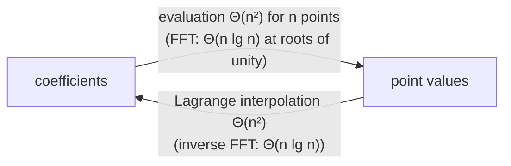

# Polynomial Evaluation & Lagrange Interpolation

## What it is
Section 30.1 introduces the two representations of a polynomial and the operations that convert between them. **Evaluation** (coefficients → point values) uses [Horner's rule](#/horner) in `Θ(n)` per point. **Interpolation** (point values → coefficients) is solved for arbitrary points by **Lagrange's formula**.

## How it works
Theorem 30.1: for any `n` point-value pairs `(x₀,y₀),…,(x_{n−1},y_{n−1})` with distinct `xₖ` there is a *unique* polynomial of degree-bound `n` through them (the Vandermonde matrix is non-singular). Lagrange's formula writes it explicitly:

`A(x) = Σₖ yₖ · Π_{j≠k} (x − xⱼ)/(xₖ − xⱼ)`

Each product is 1 at `xₖ` and 0 at all other sample points. Expanding all `n` basis polynomials costs `Θ(n²)` in total.

## Complexity
Evaluation of `n` points: `Θ(n²)` by Horner; interpolation: `Θ(n²)`. The [FFT](#/fft_recursive) improves both to `Θ(n lg n)` *only* for the special points = roots of unity.

## When to use it
Secret sharing (Shamir), error-correcting codes (Reed–Solomon), curve fitting through exact data (beware Runge's phenomenon at high degree), numerical differentiation and quadrature formulas.

## In this implementation
Floating-point coefficients, building each basis polynomial incrementally; round-trip tests recover random polynomials up to degree 7.
