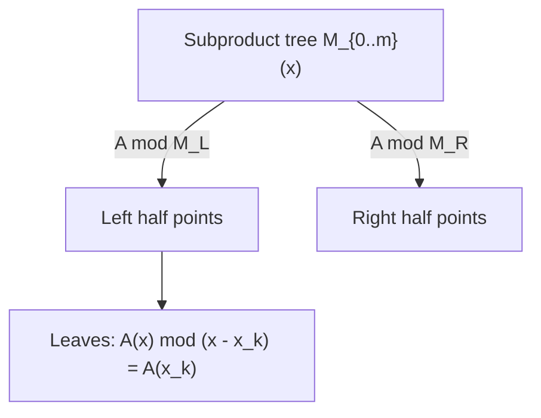

# All Derivatives & Fast Multipoint Evaluation

## What it is
Three classical applications extending [recursive FFT](#/fft_recursive) and [polynomial multiplication](#/polynomial_multiplication) (CLRS Chapter 30 problems):
1. **Multidimensional 2D FFT (`fft_2d`)**: Separable $M \times N$ transform computed by transforming rows and then columns in $O(MN \lg(MN))$ time.
2. **All Derivatives at a Point (`all_derivatives_at`)**: Evaluate $A(x_0), A'(x_0), \dots, A^{(n-1)}(x_0)$ simultaneously in $O(n \lg n)$ time instead of $O(n^2)$ repeated Horner passes.
3. **Fast Multipoint Evaluation (`multipoint_eval`)**: Evaluate degree-$n$ polynomial $A(x)$ at $m$ arbitrary points $x_0, \dots, x_{m-1}$ via a binary subproduct tree.

## How it works
* **All derivatives via convolution**: By Taylor expansion, $A^{(t)}(x_0) = \sum_{j=t}^{n-1} (a_j j!) \cdot \frac{x_0^{j-t}}{(j-t)!}$. Defining $f_j = a_j j!$ and reversed sequence $g_{n-1-k} = x_0^k / k!$, index $t + n - 1$ of the single FFT convolution $f * g$ yields $A^{(t)}(x_0)$ for every $t = 0, \dots, n-1$ at once!
* **Subproduct-tree multipoint eval**: Build a binary tree of monic polynomials $M_{l,r}(x) = \prod_{k=l}^{r-1} (x - x_k)$ bottom-up using `poly_mul_fft`. Then top-down reduce $A \bmod M_{\text{left}}$ and $A \bmod M_{\text{right}}$ recursively until leaves $(x - x_k)$ output $A(x_k) = A(x) \bmod (x - x_k)$.

## Complexity
* **2D FFT**: $\Theta(MN \lg(MN))$ for power-of-two grid $M \times N$.
* **All derivatives**: $\Theta(n \lg n)$ for a single FFT convolution.
* **Multipoint evaluation**: $O(n \lg^2 n)$ with FFT polynomial division (or $O(n \lg^2 n)$ subproduct construction + remainder tree).

## When to use it
Use 2D FFT for image filtering and PDE spectral solvers, Taylor-shift convolution for root-finding/series expansions, and subproduct trees when evaluating high-degree polynomials across many points.

## In this implementation
`fft_2d`, `all_derivatives_at`, and `multipoint_eval` reuse `fft` from `fft_recursive` and verify exact roundtrips, explicit derivatives vs repeated differentiation, and multipoint values vs Horner's rule.
