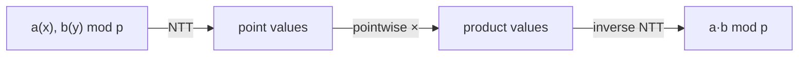

# Number-Theoretic Transform (FFT over a Finite Field)

## What it is
The [FFT](#/fft_iterative) of Chapter 30 evaluates a polynomial at the complex `n`-th roots of unity. Nothing in the algorithm needs complex numbers — only a **principal `n`-th root of unity** `ω` (a number with `ωⁿ = 1` and `Σ_{j=0}^{n−1} ω^{jk} = 0` for `0 < k < n`). Problem 30-6 asks you to carry out the FFT in a **finite field** instead. In `Z_p` with `p` prime and `n | p − 1`, `ω = g^((p−1)/n)` for a primitive root `g` is such a root. The resulting **NTT** is exact: no floating-point rounding, which makes it the standard tool for big-integer multiplication and for convolutions modulo a prime.

## How it works
Use `p = 998 244 353 = 119·2²³ + 1` with primitive root `g = 3`, so transform lengths up to `2²³` are possible. The algorithm is the iterative Cooley–Tukey butterfly with bit-reversal: at stage `len`, use `ω_len = g^((p−1)/len)` and combine `(u, v·ωᵏ)` into `(u + v, u − v)` modulo `p`. The inverse transform uses `ω⁻¹` and multiplies by `n⁻¹ mod p` ([modular inverse](#/extended_euclid)). To multiply polynomials, transform both, multiply pointwise and invert — exactly [polynomial multiplication](#/polynomial_multiplication) but with exact arithmetic.

## Complexity
`Θ(n lg n)` modular multiplications for length `n` (a power of two dividing `p − 1`); the product of two polynomials of length `n` needs three transforms of length `2n`.

## When to use it
Exact convolution of integer sequences (when results are reduced mod a prime, or the true values are smaller than `p`), big-integer multiplication via three different primes and the [Chinese remainder theorem](#/chinese_remainder), counting problems in combinatorics, and string matching with wildcards.

## In this implementation
Everything is `u64` arithmetic with products reduced immediately (`p < 2³⁰`, so no overflow). Tests compare `multiply_mod` with schoolbook multiplication on 100 random polynomial pairs, check forward/inverse round trips for all lengths up to 512, and verify the root-of-unity property.
