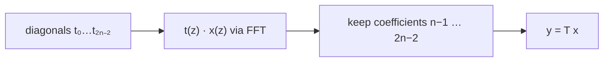

# Toeplitz Matrix-Vector Product

## What it is
A **Toeplitz matrix** `T = (t_{i−j})` is constant along every diagonal:

```
| a  b  c |
| d  a  b |
| e  d  a |
```
It is described by just `2n − 1` numbers instead of `n²`. Toeplitz matrices model linear time-invariant filters, autocorrelation, and many structured systems. Problem 30-2 asks for an `O(n lg n)` matrix-vector product — faster than the generic `Θ(n²)`.

## How it works
Matrix-vector multiplication is a **convolution** in disguise. Let `t(z) = Σ t_k z^k` (the `2n − 1` diagonal entries listed from bottom-left to top-right) and `x(z) = Σ x_j z^j`. Then

`y_i = Σ_j t_{i−j+n−1} x_j` is the coefficient of `z^{i+n−1}` in `t(z)·x(z)`.

So compute the product with the [FFT-based polynomial multiplication](#/polynomial_multiplication) (here exactly, with the [number-theoretic transform](#/number_theoretic_transform)) and read off coefficients `n−1 … 2n−2`. Circulant matrices are a special case, diagonalised directly by the DFT.



## Complexity
`Θ(n lg n)` time versus `Θ(n²)` for the straightforward product.

## When to use it
Signal-processing filters and autocorrelation, fast solvers for Toeplitz systems (Levinson–Durbin, preconditioned conjugate gradients with circulant preconditioners), and pattern matching by correlation.

## In this implementation
Arithmetic is modulo `998 244 353` through the NTT module. Tests compare the fast product with the `O(n²)` definition on 100 random matrices with full-range entries and check that a single `1` on the main diagonal gives the identity; the demo verifies `n = 2000`.
