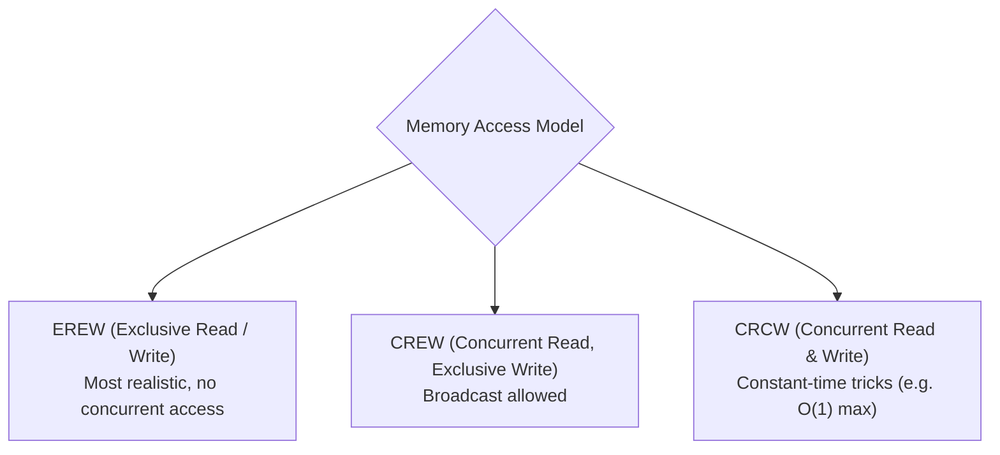

# PRAM Algorithms

## Introduction
Long before multi-core `spawn`/`sync` replaced it in CLRS 3e, the **1st edition (1990, Ch. 30)** taught **PRAM (Parallel Random-Access Machine)** algorithms—an idealized model where $p$ processors execute in synchronous lockstep sharing one giant memory. Studying PRAM teaches you fundamental building blocks still used inside GPU shaders and distributed frameworks today: **pointer jumping**, **parallel prefix scans**, **Euler tours on trees**, and **symmetry breaking**.

## What Problem Is It Solving?
When $n$ elements sit in a linked list or tree, a sequential CPU walks one pointer at a time in $\Theta(n)$ steps. PRAM asks: if we assign **one processor per node**, how fast can we compute global answers across chains, forests, and trees?
- Find distance to the end of a linked list ([List Ranking](#/list_ranking)) or roots of a forest ([Pointer Jumping](#/pointer_jumping)) in $O(\lg n)$ time.
- Compute running sums/prefixes on lists and arrays ([Parallel Prefix](#/parallel_prefix), [Work-Efficient List Prefix](#/symmetry_breaking)).
- Compute tree properties like vertex depth or subtree sizes without recursion ([Euler-Tour Technique](#/euler_tour_technique)).
- Break ties symmetrically without global coordination ([CRCW Maximum](#/crcw_maximum), [Deterministic 6-Coloring / Symmetry Breaking](#/symmetry_breaking)).

## Algorithms & Trade-Offs

| Algorithm | PRAM Model | Parallel Time | Total Work ($p \cdot T$) | Key Trade-Off |
|---|---|---|---|---|
| [List Ranking](#/list_ranking) & [Pointer Jumping](#/pointer_jumping) | EREW | $O(\lg n)$ | $\Theta(n \lg n)$ | Each step jumps `next = next[next]`, halving distance exponentially in $\lg n$ rounds; **not work-optimal** because $\Theta(n \lg n)$ beats $\Theta(n)$ sequential cost by a $\lg n$ factor. |
| [Parallel Prefix](#/parallel_prefix) (on list vs. array) | EREW | $O(\lg n)$ | $\Theta(n \lg n)$ (pointer jumping) | Easy $O(\lg n)$ time even on unordered linked lists without contiguous indices. |
| [Randomized List Prefix](#/symmetry_breaking) | EREW | $O(\lg n)$ exp. | $\Theta(n)$ **work-optimal!** | Randomly marks an independent set to splice out nodes until only $O(n/\lg n)$ nodes remain, then runs pointer jumping—eliminates the $\lg n$ work penalty! |
| [CRCW Maximum](#/crcw_maximum) ($O(n^2)$ procs vs. doubly-log tree) | Common CRCW | **$O(1)$** vs. $O(\lg \lg n)$ | $\Theta(n^2)$ vs. $\Theta(n \lg \lg n)$ | Using $n^2$ processors compares all pairs in constant $O(1)$ parallel time! Dropping processors to $n$ pays a tiny $O(\lg \lg n)$ slowdown via a tournament tree. |
| [Euler-Tour Technique](#/euler_tour_technique) | EREW | $O(\lg n)$ | $O(n \lg n)$ | Converts any rooted/unrooted tree into a single flat Euler cycle of directed edges so tree depth, parent pointers, and postorder numbering reduce to parallel prefix sums. |
| [6-Coloring & Symmetry Breaking](#/symmetry_breaking) | EREW | $O(\lg^* n)$ rounds | $O(n \lg^* n)$ | Deterministic coin-tossing looks at the lowest differing bit between each node's color and its neighbor's color—shrinks $n$-coloring to 6 colors in $\lg^* n \le 5$ steps! |

## Quick Rules of Thumb for CS Students
- **EREW vs. CRCW trade-off:** Stronger models like Common CRCW make impossible-looking bounds possible ($O(1)$ max!), but simulate them on weaker hardware and every concurrent conflict adds an $O(\lg p)$ routing slowdown.
- **Always check Work = $p \times T$:** An $O(\lg n)$-time algorithm that uses $n^2$ processors is *not* faster overall than an $O(n)$ sequential program unless you genuinely have $p \gg n$ spare processors.
- **Why $\lg^* n$ is practically constant:** Iterated logarithm $\lg^* n$ is $\le 5$ for every $n \le 2^{65536}$, which is why deterministic symmetry breaking runs in near-constant parallel rounds.
