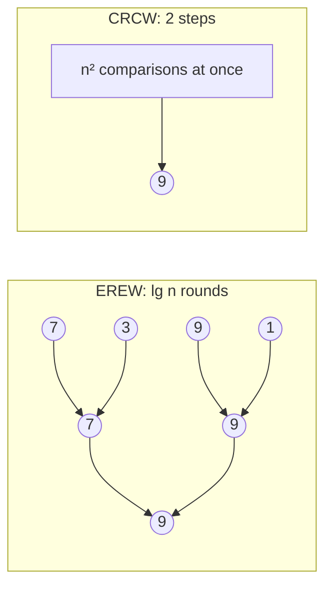

# Constant-Time Maximum on a CRCW PRAM

## What it is
PRAM variants differ in how they handle simultaneous memory access: **EREW** (exclusive read, exclusive write) is the most restrictive; **CRCW** (concurrent read, concurrent write) lets many processors touch one cell, with a rule for write conflicts (e.g. *common*: all writers must write the same value). The first-edition chapter shows how much extra power concurrency buys: the maximum of `n` numbers in **`O(1)` time**.

## How it works
Use `n²` processors, one per pair `(i, j)`, and a flag array `m[i]` (initially TRUE, meaning "`A[i]` might be the maximum"):
1. **Step 1.** Processor `(i, j)` sets `m[i] ← FALSE` if `A[i] < A[j]`. Many processors may write FALSE into the same `m[i]` — allowed on a CRCW PRAM because they all write the same value.
2. **Step 2.** Each processor `i` with `m[i] = TRUE` writes `A[i]` into the output cell. Ties write identical values, so the common-CRCW rule holds.

On an **EREW** PRAM the best possible is `Ω(lg n)` rounds — a binary tree of pairwise maxima.

## Complexity
CRCW: `O(1)` time, `n²` processors (work `Θ(n²)`); EREW: `Θ(lg n)` time, `n/2` processors (work `Θ(n)`).

## When to use it
A lesson in model sensitivity: algorithm bounds depend on the machine model. Real shared-memory hardware serialises concurrent writes (atomics), so the CRCW result is theoretical, but similar "all-pairs" tricks power GPU kernels for small `n`.

## In this implementation
Both algorithms are simulated step by step; the demo prints processor and round counts for growing `n`.
